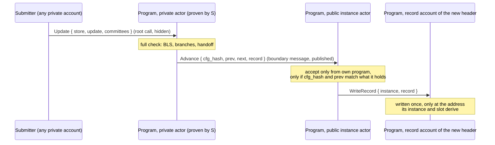

# RFP-021 proposal: Trustless Ethereum State Attestation for LEZ

Status: technical content final, measured on a LEZ `v0.4.0-rc1` node with real proofs (3–9 Nov
2026). The team fields marked TODO are still to fill. The deadline is 10 Nov 2026 (logos-co/rfp
README, DD/MM/YY).

Sections follow the fields of the RFP proposal form (`.github/ISSUE_TEMPLATE/proposal.yml`).

Evidence comes from three places:

- [code-paths.md](code-paths.md): LEZ `v0.4.0-rc1` code paths and what they cost.
- [Node runs](results.md#node-run-real-proofs-on-a-lez-v04-devnet): our program `eth_lc` on a
  running LEZ `v0.4.0-rc1` devnet (Bedrock, sequencer, indexer) with live mainnet data and real
  proofs. Deploy, Init, two updates and public and private attestations, with outcomes read from
  each block's `reverted` list and what each private transaction publishes checked.
- Native tests ([`tests/`](https://github.com/vineetpant/lez-hello-world/blob/main/tests)): the
  verifier against Helios, the adversarial suite (VS.1, VS.2) on recorded mainnet, statements,
  and history proofs on pinned mainnet blocks.
- The benchmark plan, and the conditions for a timed run, are in [bench-plan.md](bench-plan.md).

Every number in this draft is either **measured** (our own runs, logged in
[results.md](results.md)), **protocol** (read from LEZ `v0.4.0-rc1` or the Ethereum
specification), **derived** from measured numbers with the arithmetic shown, or marked **to
measure**. A number moves from "to measure" to "measured" only after a run we watched. A few
offline numbers were measured on our earlier prototype verifier; they are marked so, and are
re-measured on the delivered verifier in M0.

TODO before submission:

- project and team name, primary contact, team members
- relevant experience, with links to the Logos core and Nimbus verified-proxy work
- milestone payouts and budget
- post-delivery owner
- section 7: confirm the statement-ID and predicate interface

---

## Project summary

RFP-022's bridge, and any LEZ program that acts on Ethereum, needs one primitive: proof that a
fact holds on finalized Ethereum, verified by LEZ itself, with no committee or oracle to trust.

We build that primitive as one LEZ 0.4 program.

- **A verifier built on audited code, and held to audited logic (R.6).** The program checks each
  update with the consensus specs' light-client protocol, about 300 lines, and verifies the
  sync-committee signature with **`blst`**, the BLS library audited by NCC Group for the Ethereum
  Foundation. Its verdicts are tested against **Helios `consensus-core`**, whose consensus logic
  zkSecurity audited: on recorded mainnet and on every attack case, both reach the same result
  (section 11).
- **Updates are proven, not split.** An update carries the sync-committee BLS12-381 aggregate,
  the finality branch and the committee handoff. It runs on a private actor of the program,
  proven by whoever submits it, and lands as **one** transaction.
  - LEZ meters a private transaction at a flat **409,764 exec gas** plus its public part, and
    **224,063 storage gas** (protocol).
  - Measured on a running v0.4 devnet, end to end through the fee path: a handoff update and a
    finality update each landed in one transaction, for a net charge of **5,333,856** and
    **5,526,600** ([node run](results.md#node-run-real-proofs-on-a-lez-v04-devnet)).
  - Executing the same check publicly costs 11.4M cycles (finality only) to 12.5M (with
    handoff), measured. That's over the 10M cap of one transaction, so it splits in two. That's
    about **25× more** exec gas than the proven path's 466,762 (derived).
  - It needs no multi-transaction job protocol and no precompile.
- **The module checks the aggregate itself (F.1).** It does so inside LEZ's own execution
  proof, so no second proof system is added. This matches the RFP's own reasoning when it
  dropped the off-chain prover: "LEZ execution is already proven".
- **A public path is kept.** The same verifier core also runs publicly, split across
  transactions. It answers the central feasibility question with measurements (P.2, P.8), and
  it lets anyone submit with only a consensus endpoint and LEZ gas.
- **Consumers attest in their own transaction, publicly or privately.** A private attestation
  keeps the query inside the proof. One message crosses the boundary, a check that the
  header record is held, sent from a one-time alias (F.8).
- **Any finalized block, not just recorded ones,** so the instance needs only two updates per
  sync-committee period. The EIP-2935 history contract reaches the 8,191 blocks before a record,
  a parent-hash chain of headers reaches any block with no dependency at all, and beacon
  `historical_summaries` reach further back.
- **The Ethereum side is built by the people who built it.** All fetching and local
  verification go through the Logos Ethereum core module (Nimbus verified proxy), which a
  member of our team developed. That covers the upstream APIs the module still lacks
  (light-client objects, raw `eth_getProof` nodes), the operator daemon and the F.9
  checkpoint-verification API.

---

## Technical approach

### 1. Two things called "light client"

| | Operator's light client | On-chain verifier and state |
|---|---|---|
| What | Logos Ethereum core module (Nimbus `libverifproxy`) on the operator's machine | The attestation program's verifier code (image ID) plus its public instance and header-record actors |
| Job | Follow Ethereum, fetch updates, committee keys and inclusion proofs | Decide what LEZ accepts as a finalized Ethereum header |
| Trusted by LEZ | No. It is untrusted data delivery. | Yes. Every LEZ node checks it. |

The heavy computation moves to the operator. The trust decision stays on LEZ.

- The proof must be for the deployed program's image.
- `Advance` is accepted only from the program's own actor (`from_own_program()`). LEZ ties the
  proof to the deployed image, so it can't come from a lenient fork.
- `Advance` is accepted only on top of the store the instance currently holds.

### 2. State

Each **instance** is a public actor of the program. It holds:

- the checkpoint, chain ID, fork schedule and finality parameters, written once at Init and
  never changed (F.9, F.13)
- the current and next committee roots, which are **32 bytes each**; the 512 keys are never
  stored
- the latest finalized header

Its ID is `H(checkpoint ‖ config)`. That makes IDs impossible to squat, and lets several
instances (mainnet, Sepolia, Hoodi) coexist under one program (F.14, F.15).

**Header records** are immutable accounts, 186 bytes of state each:

- the instance, chain ID, slot, beacon root, block number, `state_root`, `receipts_root`, the
  execution block hash, which history proofs start from (section 8), and the update's signer
  count (section 10)
- at an address derived from the program, the instance and the slot, so anyone can find a
  record and no one holds a key to it
- written once, only by the program, only after a verified update
- never rewritten or removed, so an old statement stays valid forever (R.3), and every action
  reads at most one record (P.9)

### 3. Update: what has to be proven

An update must show all of the following:

1. An attested header from the current period.
2. At least 2/3 of the current committee signed it. The supplied keys must hash to the stored
   root.
3. The finality branch from the attested header to the finalized one.
4. The execution branch from the finalized header to `state_root` and `receipts_root`. For
   Gloas, `execution_block_hash` is proven at gindex 2856.
5. At a handoff, the next-committee branch inside the attested state.

A proof of new keys alone is never enough. The new keys are trusted only because the current
committee signed a header containing them:

```
checkpoint → R_N → signs H → H contains R_{N+1} → …
```

Liveness needs one update per sync-committee period (27.3 h). A stalled instance stays safe,
and anyone resumes it by submitting the missed periods' updates in order (R.7). Only an
instance stalled past 14 days, the freshness bound, needs a fresh instance (F.10).

**Replacing an instance (F.10, F.13).** An instance is replaced, never refreshed in place, when
it has stalled past the freshness bound (updates are refused with `StaleStore`), or when its
checkpoint or config is found wrong. The replacement is a new `Init` from a fresh checkpoint,
with its own ID. A consumer migrates by verifying the new checkpoint through the core module's
API (F.9) and binding to the new instance ID in a new version of its own config. Statements
already made against the old instance's records stay valid (R.3); new attestations use the new
instance. The migration guide is part of the consumer docs (S.4).

### 4. Update path A: proven (the operating mode)



**On a running node** ([node run](results.md#node-run-real-proofs-on-a-lez-v04-devnet)), with
`eth_lc`, live mainnet updates and real proofs, on the reference laptop (M3 Pro, 18 GB, CPU) at
the default segment size, 9 Nov 2026:

| | Handoff update | Finality update |
|---|---:|---:|
| Private cycles (executor) | 12.53M | 11.39M |
| Proving + submit | **2,199.6 s (36.7 min)** | **2,137.1 s (35.6 min)** |
| Peak memory | 8.4 GB | 8.7 GB |
| Public part (`Advance`, plus the record write when the update finalizes a new header) | 32,905 cycles | 56,998 cycles |
| Net charge (reserve − refund) | **5,333,856** | **5,526,600** |

A first run of the same verifier proved them in 37.8 and 35.3 min. Chrome and Brave were open
during both runs; the conditions are in [results.md](results.md).

The private fee is (409,764 + public cycles) × 8 + 224,063 × 8, so it is nearly flat: the
proven work isn't metered, and only the public part varies. Both updates were confirmed by
reading the instance and the new record account back. The finality update's public part is
larger because it writes a record account; the handoff update here finalized nothing new and
didn't.

**Init**, the public bootstrap check, costs 1,372,713 exec gas (1.36M cycles) and a charge of
11,194,336, well inside one transaction.

**Also shown on v0.4,** in an earlier experiment on the same LEZ release:

- A forged `Advance` (from another program) is refused.
- A stale store is refused.
- A replayed transaction is refused.
- A blinded sender settles, so an operator's account isn't revealed by the boundary message.
- **A losing racer is charged its full reserve.** That is what drives the deferral design in
  section 9.

**Proving on other hardware** (measured offline on our earlier prototype verifier, whose update
check was 12.9M cycles, close to the delivered verifier's 12.5M; re-measured in M0):

- An M3 Max CPU with 64 GB proved an update in **995 s, 14.1 GB peak**: about 233 s of fixed
  circuit overhead plus about 760 s for the BLS check.
- On the reference laptop, smaller segments trade time for memory: 5.3 GB peak in 34.6 min at
  2^19, 3.9 GB in 48 min at 2^18. So an 8 GB laptop can operate the module on CPU.
- A finality-only update, the common case, proved about 12% faster than one with a handoff.
- GPU proving is measured in M0.

**Catch-up:** one private execution can verify several consecutive periods, so a stalled
instance resumes in one transaction (R.7). To be measured.

### 5. Update path B: public split (fallback and measurement)

- The same verifier runs as public actor messages, spread across blocks. Each step must
  fit `MAX_GAS_EXEC` = 10M, which caps both a transaction's gas limit and a whole block.
- On the delivered verifier an update is 11.4–12.5M cycles (measured), so the split takes two
  steps. On our earlier prototype verifier it was measured as **prepare**, every check except
  the pairing (4.93M cycles, handing over 741 bytes), then **pairing** (7.85M): two transactions
  in two blocks, at least 20 s. Re-measured on the delivered verifier in M0.
- Where the cycles go (same prototype): the pairing was 61% of an update and hash to G2 9%, even
  with the BLS accelerator. A pairing precompile is the main lever (P.8).
- It needs no prover, so anyone can advance the instance with only a consensus endpoint and LEZ
  gas (F.11, S.7).
- It produces the public numbers for P.2 and the precompile comparison for P.8. A precompile is
  reachable only from public transactions.
- **Both paths write the same header record.** Consumers can't tell which path wrote it.

### 6. Attestation

The consumer program builds the predicate. The user or relayer supplies only the Ethereum proof.

- **Public:** the consumer's message to the record account runs on the sequencer, with an MPT
  check and predicates. A WETH storage slot plus its account, at the record: **301,115 exec
  gas**, 3% of the 10M cap (measured on the node). On our earlier prototype, the bare check was
  52–69k cycles for a receipt log and 190k for a storage slot, and each extra predicate about
  1k; re-measured in M0.
- **Private:** `AttestPrivate` runs on a private actor of the program, inside the consumer's
  private transaction.
  - The query, the Ethereum proof and the predicates are evaluated inside the proof and never
    published.
  - **One message crosses the boundary:** `CheckRecord { instance, record }`, a synchronous
    call to that record's account. The account accepts it only from the program's own actors,
    only at the address its instance and slot derive, and refuses unless it holds that record.
    It carries the header record and nothing about the query.
  - **The sender is a one-time alias.** The v0.4 wallet presents a fresh blinded alias for each
    message from a private account (protocol: `lez/wallet/src/account_manager.rs`, `presenter`),
    so the consumer's account is never published and two attestations can't be linked through
    it.
  - **Fees don't link either.** Refunds return to the fee payer's blinded alias, never to a
    public account.
  - **The check can't go stale.** Header records are immutable, so a record held when the
    consumer proves is still held at inclusion (R.11).
  - **What is published:** the program, the instance, which header record was used, and the
    time. To keep the record from narrowing down the event, consumers attest against the newest
    record and reach the event's block through history proofs (section 8). What is left is
    "proved after that header", which the submission time already shows.
  - **Alternative considered:** reading the record with a cross-boundary state read instead of
    a call. It would publish the same thing, the record and a blinded reader, so it gains no
    privacy. We use `CheckRecord` because it runs on v0.4 today.
  - **F.8 evidence (M2):** every boundary crossing of a private attestation enumerated, and the
    full public state diffed before and after
    ([#7](https://github.com/vineetpant/lez-hello-world/issues/7)).
- **Measured on a running node** ([node run](results.md#node-run-real-proofs-on-a-lez-v04-devnet)), WETH storage slot plus account
  against a header the instance verified, real proofs, reference laptop:

  | | Public | Private |
  |---|---:|---:|
  | Exec gas | 301,115 (3.0% of the cap) | 20,281 public cycles; the rest is proven |
  | Transaction size | 7,514 B | — |
  | Charge, accepted | **2,469,032** | **5,232,864** net |
  | Time | included in 12 s | 853–912 s proving + submit |
  | Peak memory | — | 7.3–7.8 GB |
  | Charge, refused | **16,060,112** (the whole gas limit) | 0: nothing is submitted |

  Measured 9 Nov 2026. An earlier design, with records in a bounded ring inside the instance,
  cost about 46k more per public attestation (D8).

  - Honest attestations were accepted on both paths. A tampered proof and a false claim were
    refused on both: reverted in their block on the public path, unprovable on the private
    one, so the wallet never sent them. A header the instance never verified was refused on
    the private path.
  - On the public path a refusal is charged the whole gas limit, 6.5× an accepted one. So the
    CLI dry-runs the check before submitting and stops on a refusal (U.2, measured). Setting a
    tight gas limit from the measured cycles is M3 work
    ([#25](https://github.com/vineetpant/lez-hello-world/issues/25)).
  - **The design above, on the node** ([what it publishes](results.md#node-run-real-proofs-on-a-lez-v04-devnet)).
    The private attestation crossed the boundary with one `CheckRecord` call from a one-time
    alias, plus the fee reserve to the fee inbox from another, and its refund went to the
    payer's alias. A search of the whole transaction, proof included, found none of the
    wallet's private accounts, the payer, the queried address, the slot or the proof leaves.
    The reserve amount is public; it is priced from the transaction's public part, so it
    reveals nothing about the query.
  - **Not tested:** a modified wallet that skips the local run and submits anyway. The
    sequencer would then run the record check itself
    ([#26](https://github.com/vineetpant/lez-hello-world/issues/26)).
  - **Minimum spec for a consumer's private attestation (P.4).** Measured peak: 7.3–7.8 GB at
    the default segment size, 14.2–15.2 min on the reference laptop (M3 Pro, 18 GB, CPU). We
    declare 16 GB of RAM, CPU proving, as the supported minimum today, with a light desktop
    load: with two browsers open, the reference laptop swapped and a proof took about 3×
    longer. Smaller segments brought an update down to 3.9 GB (section 4); the same setting is
    measured for the attestation in M2, aiming at 8 GB.
- **Verified once, used many times.** Attestation never re-verifies an update or its
  signature. It trusts a header record because only the program writes it, and only after
  verification.
- **R.11 (independent submissions):** header records are immutable and attestation writes no
  shared state. Several private attestations can land in one block, and each can compute its
  result before inclusion.

### 7. Predicates and statements

**Fields:**

- account: balance, nonce, code hash
- storage slot, with offset and width for packed slots
- log: address, topics, data word, topic count, data length

**Values:** uint, int (two's complement), address, bytes32.

**Comparisons:** `= ≠ < ≤ > ≥`, combined with AND over several proofs under one header (soft
#4).

**Helpers:** Solidity mapping-slot derivation.

**Statements.** A claim holds against one record, and the module returns a statement:

```
Statement { instance, chain_id, block_number, facts: [ (class, id) … ], conditions }
```

- `instance` binds the statement to the instance whose record it was checked against, so a
  consumer bound to one instance rejects another's (F.15). `chain_id` is the chain the record
  belongs to, checked against the claim's (F.5).
- One `(class, id)` per fact, in the order the claim gives them. A compound claim over several
  facts (soft #4) carries one ID per fact, so a consumer keys its nullifier on the fact it means
  to consume, never on a combination that a different compound could avoid.

**Statement IDs (F.6).** Each fact's ID is a deterministic, collision-resistant hash of the
Ethereum state it proves, and of nothing else:

```
id = SHA-256( "eth_lc/statement/v1" ‖ chain_id ‖ kind ‖ fields )
```

| Kind | Fields | Class |
|---|---|---|
| storage | `address ‖ slot ‖ value` | state |
| account | `address ‖ nonce ‖ balance ‖ code_hash` | state |
| log | `block_hash ‖ tx_index ‖ log_index ‖ address ‖ n_topics ‖ topics ‖ len(data) ‖ data` | occurrence |

- **Deterministic.** The ID depends only on the attested state: not on the instance, the
  record, the proof's bytes, the predicate or the path (public, private, dry run). So identical
  state gives an identical ID, and two consumers with different predicates over one event derive
  the same one, as F.6 asks.
- **Collision-resistant.** Every field is fixed-width (integers as 8-byte little-endian, words
  as 32 bytes) or length-prefixed, the kind is a tag byte, and the domain string is versioned, so
  the encoding is injective and distinct state gives a distinct ID. A predicate over the account
  (balance, nonce, code hash) yields an **account** fact, whose ID covers those fields; a
  predicate over a slot yields a **storage** fact.
- **Classes, carried in the statement** (S.4):
  - **occurrence** (logs): one ID per event, safe as a one-shot nullifier.
  - **state** (storage, account): the same state is the same ID at any block, as F.6 requires,
    so the same value at two times collides. The docs mark these "unsafe as a one-shot
    nullifier unless the state is write-once"; the reference vault uses a write-once deposit
    mapping.
- **Published derivation.** The encoding is part of the IDL (U.4), with test vectors, so a
  consumer in any language derives the same ID without inventing its own.
- **Tests (M2):** per kind, the same state at two blocks gives the same ID; one changed field
  (including a moved topic/data boundary) gives a different one; the ID is equal on the public
  path, the private path and the dry run.

**Reference consumers (U.6):**

- **ERC-20 deposit:** a `Transfer` log to the vault.
- **Native ETH:** the vault's `receive()` emits `Deposit(sender, amount, nonce)`.
  - `msg.sender` is the real sender, including Safe, ERC-4337 and EIP-7702 accounts.
  - No transaction-trie parsing and no secp256k1 recovery sit in the trusted path.

**Typed errors (U.5).** Every refusal is one code, the same in the program, the CLI's dry run
and the docs:

| Failure mode (U.5) | Code |
|---|---|
| Header not finalized | 100 `UnfinalizedHeader` |
| Sync-committee signature invalid | 101 `InvalidSignature`, 102 `InsufficientSigners` |
| Committee handoff not verified | 103 `UnverifiedHandoff`, 104 `CommitteeKeysMismatch`, 105 `InvalidCommitteeProof` |
| Execution roots not proven | 106 `InvalidExecutionProof` |
| Checkpoint stale or wrong | 107 `StaleStore`, 120 `CheckpointRootMismatch` |
| Update already applied (R.8) | 108 `UpdateNotNewer` |
| Inclusion proof invalid | 200 `InvalidInclusionProof` |
| Predicate not satisfied | 201 `ConditionUnsatisfied` |
| Chain-ID mismatch | 202 `WrongChain` |
| Malformed input | 1 `MalformedInput` |

Measured on the node: the CLI's dry run of a public attestation returns the code the program
refuses with (`InvalidInclusionProof` for a tampered proof, `ConditionUnsatisfied` for a false
claim, `InvalidExecutionProof` for a forged history header), and stops before submitting. v0.4
blocks record that a transaction reverted but not why, so the dry run is also where a consumer
reads the code.

### 8. Historical state (soft #3)

An attestation can target any finalized block, not only one the instance recorded. That is
what lets the instance run on two updates per period (section 9).

- **Primary, the 8,191 blocks before a record: EIP-2935.** The history contract, live since
  Pectra on mainnet, Sepolia and Hoodi, keeps the last 8,191 block hashes in state. A storage
  proof under the record's `state_root` gives the target's block hash. The target's RLP header,
  which must hash to it, gives its `state_root` and `receipts_root`, and the attestation
  proceeds against those. It is the same storage-proof code a slot attestation uses, plus the
  RLP decode the verifier already has for Gloas.
- **Fallback, any distance: a parent-hash chain.** The consumer supplies the headers from the
  record back to the target, each checked against its child's `parentHash`. It depends on
  nothing but Ethereum's header hashes, so it also covers a chain without EIP-2935 (F.14). The
  cost grows with the distance, about one keccak and 600 bytes a block. On the public path that
  suits short gaps; on the private path the work is inside the consumer's proof, which the fee
  doesn't meter, so it costs proving time only.
- **Older than about 27 h:** beacon `historical_summaries` ([#28](https://github.com/vineetpant/lez-hello-world/issues/28)).
- **Measured on the node** ([node run](results.md#node-run-real-proofs-on-a-lez-v04-devnet), real proofs, 9 Nov):

  | Target | Public | Private |
  |---|---:|---:|
  | The record's own block | 2,469,032 (301k exec gas, 7.5 KB) | 5,232,864 |
  | 1,000 blocks back, EIP-2935 | **4,504,320** (549k exec gas, 13.9 KB; 5.5% of the cap) | **5,232,864** |
  | 3 blocks back, parent-hash chain | **3,297,992** (402k exec gas, 10.1 KB; 4.0% of the cap) | **5,232,864** |

  All accepted, all publication checks passed (the target's header and history slot are not
  in the transaction), and a forged history header was refused on both paths
  (`InvalidExecutionProof`). In private, reaching an older block costs nothing extra: the
  history proof is checked inside the consumer's proof, the published part is the same
  `CheckRecord`, and proving took the same 853–912 s.
- **Also tested natively** ([`tests/history.rs`](https://github.com/vineetpant/lez-hello-world/blob/main/tests/history.rs), 6 tests,
  passing, on pinned mainnet blocks). EIP-2935 reaches a block 50 back from the record, and a
  parent-hash chain one 3 back. A forged header, the slot of another block, another contract,
  a target outside the window, a broken link and the wrong anchor are each refused. The
  record carries its execution block hash, verified inside the update's proof, so the chain
  starts from a hash the program checked.

### 8b. Recorded statements and batching (soft #1, #2)

- **Recorded-statement account (soft #1).** A third message, `Record`, runs the same
  `statement::check` as the direct path and writes the statement once to an account derived
  from the instance and the statement ID. Consumers that care about the same Ethereum state read
  that account instead of each verifying, so the cost is paid once. The verification core and
  its audit surface are shared with the direct path, as in RFP-020. The docs state the trade the
  RFP asks for: a consumer reading a recorded statement trusts whoever wrote it. Here only the
  program can write that account, after the same check, so a consumer that confirms the account
  is the one the ID derives trusts nothing more; but it acts on a result computed in an earlier
  transaction, which the direct path (F.7) avoids. It is public by nature, so it is for public
  consumers only.
- **Batching (soft #2).** A claim already carries several conditions over one fact; a batch
  carries several facts under one record in one message, so the record is read and the message
  decoded once, and each fact gets its own statement ID (section 7). Measured per extra fact in
  M2.

### 9. Operator daemon (U.3, R.4, R.5, R.8–R.10)

The daemon is a Logos module plus a Logos Core headless CLI.

- It follows Ethereum through the core module and tracks the instance from LEZ events
  (LP-0012).
- **Cadence: two updates per sync-committee period (27.3 h), 642 a year.**
  - the mandatory handoff
  - one about 13.7 h later, so consecutive records stay well inside the 8,191-block history
    window and every block between them can be proven from the later one (section 8)
  - on demand, for an event newer than the latest record, paid by whoever needs it: about
    0.47M exec gas
  - Tracking costs about 11.05M a period at the base-fee floor, 3.55 × 10⁹ a year, 0.001% of
    the period's exec capacity ([derived](results.md#derived)). There is no heartbeat.
- **Re-check before submit (R.9):** a losing racer pays its whole reserve (section 4). The daemon
  re-reads the instance immediately before sending and keeps its reserve tight.
- **Deferral (R.10):** a per-instance, per-period delay spreads cost across operators (section
  13). Documented with its effect on latency.
- **Restart (R.4, R.5):** the daemon resumes from the instance on LEZ. It never re-verifies from
  the checkpoint and never repeats work already applied.
- **Running it (U.3):** standalone, as a Logos module with a Logos Core headless CLI.
  Configurable consensus and execution endpoints (several of each, none trusted), the LEZ
  sequencer endpoint and the instance ID; structured (JSON) logs of every fetch, check, proof
  and submission; a clean shutdown on SIGINT/SIGTERM that finishes or abandons an in-flight
  proof without submitting a partial result. The operator journey (install, configure, run,
  monitor) is documented, with the metrics to watch: the instance's finalized slot against the
  chain's, and the time since the last update.

**The operator role (S.7).** No party is obliged to operate an instance: liveness rests on
interested parties choosing to spend the gas.
- **Needs:** a consensus endpoint and LEZ gas, plus a prover and a private account for the proven
  path (the public split path needs no prover). No standing on Ethereum, and no permission:
  anyone starts one (F.11).
- **Costs:** per update about 0.47M exec gas and 224k storage gas, 5.3–5.5M at the base-fee
  floor; 35.6–36.7 min and 8.4–8.7 GB of proving on the reference laptop (measured). At the
  recommended cadence, about 11.05M a period.
- **Cadence:** two updates per period, as above, plus on demand.
- **Alongside other operators:** only one update per store applies; a losing submitter's update
  reverts and it pays its reserve. The re-check and deferral (R.9, R.10) keep that rare.
- **Detecting a stall:** the instance's finalized slot is behind the chain's by more than a
  period, or no update has landed for longer than the cadence. Anyone can then resume it (R.7).

### 9b. Operator incentive (soft #5)

Liveness doesn't depend on this. Anyone can still advance an instance by paying the gas. It
gives operators a reason to keep doing so.

- **Pool.** Each instance has a bounty pool: a PDA of the program, seeded by the instance ID.
  Anyone can fund it with an ordinary native-token `Transfer`: consumers, protocols that depend
  on fresh headers, or a grant.
- **Payout.** A successful `Advance` pays the recipient the update names, using
  `custody_transfer` from the pool. The fee program uses the same primitive.
  - The amount is `min(pool, rate × Δslots, cap)`, where Δslots is how far the new finalized
    header is past the previous one.
  - `rate` and `cap` are part of the instance's immutable config.
  - The payout grows with how stale the instance was, measured in Ethereum time, which the
    update itself proves. No LEZ clock read is needed.
- **Why it grows with staleness.** An operator submits once the payout covers its cost (about
  467k exec gas plus storage). Operators with different costs reach that point at different
  moments, which spreads submissions over time instead of starting a race. Frequent tiny updates
  earn tiny payouts, so there's nothing to gain from spamming.
- **Permissionless (F.11).** No registration and no allow-list. Whoever lands the `Advance`
  claims the payout. The `pre_state == prev` check already selects exactly one winner per step.
- **Racing.** A losing submitter still pays its reserve. The bounty doesn't change that, so the
  re-check and deferral of section 9 stay.
- **Attestation fee, optional per instance.** A consumer can add a flat transfer to the pool in
  its own transaction. In a private attestation that is one more boundary crossing. A flat
  amount reveals nothing about the query.
- **Known limits.**
  - The recipient is credited asynchronously, in a later transaction.
  - The payout recipient is public, so a submitter that wants privacy names a fresh account.
  - Funding is voluntary. An unfunded pool pays nothing, and the system behaves as without
    the bounty.

### 10. Security model (S.6, VS.1–VS.6)

- **Fabricated chain (VS.1):** an explicit adversarial test. A self-consistent header plus
  inclusion proof over state that was never finalized must be rejected.
- **Committee attack cost.** Following the chain through the sync committee trusts that at
  least 342 of its 512 members are honest. Sync-committee signatures are not slashable today,
  so a dishonest signature costs a member little beyond the reward for that slot. There are two
  ways to get 342 signatures on a header that was never finalized:
  - **Luck.** An entity holding stake share *f* draws seats roughly as Binomial(512, *f*). The
    chance of drawing ≥ 342 seats in one period (27.3 h; 321 periods a year):

    | *f* | P(≥ 342) | P(≥ 410) | P(≥ 461) |
    |---|---|---|---|
    | 0.33 | 6e-55 | 4e-106 | 1e-160 |
    | 0.50 | 1e-14 | 5e-45 | 6e-84 |
    | 0.60 | 9e-4 | 2e-22 | 2e-52 |
    | 0.67 | 0.50 | 1e-11 | 3e-35 |

    Below about 50% of stake this is negligible, even over a year of periods. At 60% it is about
    25% per year at the default threshold. An entity with that much stake can already disrupt
    Ethereum consensus itself.
  - **Bribery.** Each committee is known about a period ahead. An attacker can pay 342 members,
    or the few large operators that control many seats, to sign a false header. The cost is
    whatever those members accept, not stake at risk. We state this plainly. Security for
    high-value consumers comes from the defences below, not from a dollar figure.
- **Consumer defences (VS.4).** The record carries the update's signer count. A consumer
  chooses its own policy:
  - **A higher participation threshold.** For example, 410 (80%) or 461 (90%). An attacker then
    needs that many seats, which moves the luck columns above by tens of orders of magnitude.
    The four mainnet updates in our recorded segment had 510–512 signers. A larger sample,
    measured in M1, sets how often a high threshold costs liveness.
  - **The two-committee rule.** Act only on a header that the next committee has also built on.
    An attacker then needs supermajorities in two independently drawn committees: the luck
    probability is squared, and the bribe covers two sets of members.
  - **Value caps** per header or per period, for consumers that need neither.
  - **A freeze authority** on the consumer side, as RFP-022 specifies, to halt minting when a
    committee is suspected compromised.
- **What a compromised committee can do (VS.4).** A colluding supermajority can sign a header
  that was never finalized, and every record and statement under it then attests to state that
  doesn't exist; it can't alter records already written, or statements made against honest
  headers. Exposure is bounded by the consumer defences above.
- The table is reproducible from the binomial tail:
  `sum(comb(512, i) * f**i * (1 - f)**(512 - i) for i in range(k, 513))`.
- **No swappable verification (VS.3):** no `ProgramId` is held in mutable state. Instances are
  immutable. Migration is to a new program version plus a new instance. The consumer docs (S.4)
  state the same rule for consumers: a consumer that holds this module's `ProgramId` in mutable
  state lets whoever controls that pointer substitute a module that attests to anything, so a
  consumer fixes the module and the instance it trusts in its own immutable code or config.
- **Immutable deployment.** `from_own_program()` compares program addresses, not code, so the
  program is deployed with `ProgramHeader.immutable = true`. LEZ v0.4's loader then refuses
  `UpdateHeader` on it (`program_loader/core/src/lib.rs:93`). Segments and headers are
  write-once, so nothing else in the protocol can change the program. A protocol upgrade of LEZ
  itself is outside this guarantee, and the trust document says so.
- **Config bound to the instance.** The checkpoint, chain ID, fork schedule and freshness bound
  are written at `Init`; `Advance` carries the hash of the config the update was verified under
  and is refused unless it matches the instance's, and the config is part of the instance ID
  (F.14, F.15). The participation threshold is the specs' 2/3, fixed in the verifier; stricter
  thresholds are the consumer's, from the record's signer count. A submitter can't supply a
  weaker config.
- **Accepted on proof validity alone (VS.6).** Nothing in `Update` or `Advance` reads who
  submitted it: any account with a valid proof advances the instance, and an invalid one is
  refused whoever sends it.
- **Already exercised** ([`tests/adversarial.rs`](https://github.com/vineetpant/lez-hello-world/blob/main/tests/adversarial.rs)
  and [`tests/statement.rs`](https://github.com/vineetpant/lez-hello-world/blob/main/tests/statement.rs),
  passing, natively on recorded mainnet). Each asserts the exact error, next to an honest
  control that passes, and each update case must be refused by Helios too:
  - **VS.1:** a fabricated chain, self-consistent throughout. A fabricated execution state root
    is committed in the finalized header, that header in the attested state, and the attested
    header is signed by all 512 keys of a committee we generated. Refused:
    `CommitteeKeysMismatch`. The control: against a store that trusted that committee, the same
    update verifies in both, so the refusal comes from the committee chain back to the
    checkpoint. A fabricated checkpoint header: `CheckpointRootMismatch`.
  - **VS.2:** a committee never handed off (`UnverifiedHandoff`), a forged next committee
    (`InvalidCommitteeProof`), 341 of 512 signers (`InsufficientSigners`), a header not finalized
    (`UnfinalizedHeader`), tampered execution roots (`InvalidExecutionProof`), an update under
    another chain's domain or with a tampered signature (`InvalidSignature`), a replayed update
    (`UpdateNotNewer`); and for statements, a tampered proof or root (`InvalidInclusionProof`), a
    false claim (`ConditionUnsatisfied`), a proof replayed to another chain (`WrongChain`), a
    predicate over state the proof doesn't cover (`MalformedInput`), and a log proof for another
    transaction (`InvalidInclusionProof`).
  - The attestation cases also run through the deployed program on the node: tampered proof,
    false claim, forged history header and unheld record were all refused there.

### 10b. Off-chain participants (F.12)

| Participant | What it does | Safety or liveness | If it declines or misbehaves |
|---|---|---|---|
| Checkpoint supplier (whoever runs `Init`) | Picks the weak-subjectivity checkpoint and config | **Safety**, once, at `Init` | A wrong checkpoint gives an instance of the wrong chain. Consumers verify the checkpoint through the core module's API (F.9) before binding to an instance, and a bad instance is never fixed in place, only replaced (F.10, F.13) |
| Beacon API source | Serves light-client updates and committee keys | Liveness | Everything it serves is verified. Any beacon node, ours or public, serves the same data |
| Operator (update submitter) | Proves and submits updates | Liveness | Anyone can submit, with no registration (F.11). The public split path needs no prover, only a consensus endpoint and LEZ gas |
| Execution RPC | Serves `eth_getProof` and receipts | Liveness | Every proof is checked against a verified record. Any archive or full node serves them |
| Consumer's prover (private path) | Proves the consumer's own transaction on the consumer's machine | Liveness, for that consumer only | No third party sees the query |
| Relayer (public path, optional) | Submits a consumer's attestation | Liveness | The consumer can submit it directly |
| Sync committee | Signs headers | **Safety**: the honest-supermajority assumption | Section 10: attack cost and consumer defences |

No participant other than the checkpoint supplier and the sync committee can affect safety, and
each liveness role can be filled by anyone. So no party, alone or as a class, can stop an
attestation from eventually being produced: a consumer who needs a header can fetch the update
and submit it itself.

**What each participant can observe (S.6):**

| Participant | Observes |
|---|---|
| Beacon API source | Which periods and updates an operator fetches; nothing about consumers |
| Execution RPC | **The consumer's query**: the address, slot or transaction it fetches a proof for, and the requester's network address. A consumer that needs this private runs its own node, or fetches through the Logos Ethereum core module against its own endpoint; it also learns nothing it can link to the LEZ transaction, which carries no query detail (F.8) |
| Operator | Public LEZ state and the update material, which are public anyway |
| LEZ sequencer and everyone on LEZ | For a public attestation, the whole query. For a private one, only the program, the instance, the record used, the fee reserve and the time, from one-time aliases (section 6) |
| Relayer (public path) | The consumer's public attestation, which is public once submitted |
| Consumer's prover | Everything about the consumer's query; it runs on the consumer's own machine |

**The trust model, stated to users and developers (VS.5).** Verification is trustless: LEZ
accepts a header only on a valid proof of the sync committee's signature from the checkpoint
forward. Every off-chain participant except the checkpoint supplier and the sync committee is
liveness-only, and the user-facing and developer-facing docs say so.

### 11. Reuse assessment (R.6)

**What runs in the program, and why it can be trusted:**

| Layer | What | Assurance |
|---|---|---|
| BLS12-381 signatures | `blst`, through RISC Zero's accelerated fork | `blst` audited by NCC Group for the Ethereum Foundation (2021); formal verification by Galois in progress. The fork moves its field arithmetic onto the zkVM's accelerator; that change is in our audit |
| Light-client protocol | the consensus specs' `validate_light_client_update` and `apply_light_client_update`, for finalized headers, about 300 lines (`lc/types/src/core.rs`) | held to Helios `consensus-core`, whose logic zkSecurity audited (in `r0vm-helios`), by a differential suite; in our audit |
| Hashing, inclusion proofs | RISC Zero's accelerated SHA-256 and Keccak; `alloy-trie`, `alloy-rlp` | the Rust Ethereum stack's standard libraries |
| Execution | inside LEZ's own execution proof, deployed immutable | LEZ verifies the proof against the program's image |

**The differential suite** (`tests/oracle.rs`, `tests/adversarial.rs`): every recorded mainnet
update, from a checkpoint through two committee handoffs to a finality update, goes through our
verifier and through Helios, and both must reach the same store. Every attack (a fabricated chain
signed by a committee we generated, a committee never handed off, a forged next committee, 341 of
512 signers, an unfinalized header, tampered roots, another chain's domain, a replay) must be
refused by both. Our SSZ roots are checked equal to Helios's for every committee and header. A
disagreement fails CI.

**Why not run Helios itself in the program.** Its protocol logic is the same as ours, but it
verifies signatures with the `bls12_381` crate, which can't be swapped and costs far more in the
zkVM: an update is **39.5M cycles** through Helios, about 34M of it in BLS, against **11.4M**
here (measured). `r0vm-helios` stops at the Electra fork, so it can't verify today's mainnet, and
it targets risc0 2.0 and an EVM verifier.

**Audit-surface consequence.** The audit (M5) covers our verifier, the accelerated `blst` fork's
use, the LEZ actor and its trust boundary, and the inclusion and statement code. The differential
suite gives the auditor an audited reference to check the protocol logic against.

### 12. Dependency check against the live runtime

| Dependency | Status | Our handling |
|---|---|---|
| LEZ testnet 0.4 (S.1) | `v0.4.0-rc1` tagged 29 Oct. The public testnet 0.4 is not live as of 9 Nov | Build and measure on the rc now. Run end-to-end tests on a local v0.4 devnet with a standalone sequencer (S.2). Deploy to testnet 0.4 in M4 once it launches. Re-measure on the final 0.4 |
| SPEL IDL (U.4) | SPEL `v0.7.0-rc.3` supports neither LEZ v0.3 nor v0.4 (spel#291) | Hand-written SPEL-format IDL, with a drift check in CI |
| Logos Ethereum core module | No light-client objects or raw `eth_getProof` nodes | Our team member extends it upstream (U.1, F.9) |
| Standalone sequencer + Bedrock (S.2) | No published Bedrock release matches v0.4's pin. Built from source at the pinned commit, it runs: our local devnet (one Bedrock node, sequencer, indexer) ran deploy, Init, updates and attestations on 3–9 Nov | e2e on this devnet. Known issue: the sequencer's Bedrock funding key drains after about 1,350 blocks and must be topped up |

### 13. Reliability (R.1–R.12)

How each Reliability item is met, by mechanism, with where it is enforced and how it is shown.

**R.1 Deterministic verification.**
- The verifier (`core::update`, `statement::check`, `history::target_record`) is a pure
  function of its inputs: no clock, no randomness, no host calls. Time enters only as the
  transaction's `timestamp_window`, which the sequencer enforces outside the verdict.
- The same code runs natively in the client, in the dry run and inside the program, so a
  verdict is reproducible from `cargo test`. The differential suite runs every recorded update
  through Helios as well; a disagreement fails the test.
- Evidence: `tests/statement.rs` (`..._is_deterministic`), `tests/oracle.rs`.

**R.2 Read-only for the consumer, retry always possible.**
- `Attest`, `AttestPrivate` and `CheckRecord` return `keep_state()`: they write neither the
  record nor the consumer. No nullifier is spent by the module; spending one is the consumer's
  own step after a statement is returned (section 7).
- Every refusal is a panic with a typed `Refusal`, so a public refusal reverts the whole
  transaction and the consumer's state is untouched. A private refusal fails in the wallet's
  local run, before a proof exists, so nothing is sent.
- The CLI dry-runs a public attestation and stops on a refusal with the same code (U.2).
- Evidence: node run, every broken attestation refused on both paths, retried honestly after.

**R.3 Statements stay valid forever.**
- A statement is checked against a record account, written once by `WriteRecord`
  (`write_once` refuses a second write) at `for_public_pda(program, H(instance ‖ slot))`. No
  message deletes or rewrites one, and a later update or committee rotation only adds records.
- An old record also reaches older blocks through EIP-2935 or a parent-hash chain (section 8).
- Evidence: node run (records written, read back, attested against after later updates);
  `tests/lc.rs` walks two handoffs.

**R.4 Handoff tracking survives a restart.**
- The verified state lives only on LEZ: the instance holds the store (finalized header,
  current and next committee roots). The daemon keeps no state it needs: on start it reads the
  instance and fetches the update for the period after the store's.
- An unverified handoff can't be accepted: an update signed in a period whose committee the
  store doesn't hold is refused (`UnverifiedHandoff`), and supplied keys must hash to the stored
  root (`CommitteeKeysMismatch`).
- Evidence: `tests/adversarial.rs` (committee never handed off). Kill-and-restart test of the
  daemon in M3.

**R.5 Ethereum-side outages are recoverable.**
- Every fetch is idempotent and verified before use (Beacon API updates checked natively with
  the same verifier, `eth_getProof` checked against a record), so a failed or partial fetch is
  simply repeated. The daemon's only side effect is a LEZ transaction, and it reads the
  instance before sending one, so nothing already applied is redone.
- Several endpoints can serve the same data; switching costs nothing, since none is trusted.
- Evidence: fault-injection tests of the daemon (dropped RPC, timeouts) in M3.

**R.6 Reuse of audited implementations.** Section 11.

**R.7 A stalled instance stays safe and resumes.**
- Safety: records never change, so attestations against them keep verifying whatever the
  instance does.
- Resumption: the spec light client advances one period at a time. Each missed period's
  update is signed by the committee whose root the store already holds and carries the next
  one's branch, so anyone (no registration, F.11) submits them in order and the handoff chain
  has no gap. The Beacon API serves past periods' updates (`light_client/updates?start_period`).
  Catch-up of several periods in one private transaction is measured in M1.
- Bound: past `max_store_age` (14 days) from the store's finalized slot, the weak-subjectivity
  limit, updates are refused (`StaleStore`), and the transaction's validity window ends there,
  so the sequencer's clock refuses it too. The instance is then replaced, not repaired (F.10).
- Evidence: `tests/lc.rs` advances a store across two periods in order; stall test in M1.

**R.8 Concurrent submissions never double-apply.**
- `Advance` carries `prev`, the store the update was verified on, and the config hash. The
  instance applies it only if `prev` equals the store it holds and the config matches; anything
  else reverts. Two updates verified on the same store can't both apply, and a replay can't
  apply at all (`UpdateNotNewer` in the verifier as well).
- `Advance` is accepted only from the program's own actor (`from_own_program`), so a store
  can't be pushed directly.
- Evidence: `tests/adversarial.rs` (replayed update); on v0.4 a losing racer was refused and
  charged its reserve (section 4). Two-operator test in M3.

**R.9 Re-check before submitting.**
- The daemon reads the instance immediately before submitting and drops an update whose
  `prev` no longer matches, or that another party's update has made unnecessary (the store's
  period and finalized slot already at or past it).
- Because a losing racer pays its whole reserve, the daemon also sets the reserve from the
  measured public part, so a lost race costs the minimum.
- Evidence: multi-operator test in M3 (#11).

**R.10 Deferral spreads cost across operators.**
- Each daemon waits `d = H(operator key ‖ instance ‖ period) mod D` after an update becomes
  available, then re-checks (R.9) and submits only if nobody has. The hash varies the order
  per period, so over many periods each operator submits about `1/n` of the updates.
- `D` is configurable; the default trades at most `D` of extra latency for the spread. The
  latency effect is documented with the cadence (section 9). An on-demand update, paid by the
  party who needs it, skips the deferral.
- Optionally the bounty pool (section 9b) pays the submitter, so a deferred operator is not
  out of pocket.
- Evidence: multi-operator test in M3: submissions per operator and added latency.

**R.11 Statements are independent.**
- An attestation reads one immutable record and writes nothing shared: `CheckRecord` is a
  read under `keep_state()`. So private attestations don't conflict, any number can land in one
  block, and each can compute its result before inclusion: a record held when the consumer
  proves is still held at inclusion.
- Evidence: same-block private attestations test in M2.

**R.12 Green CI.** GitHub Actions runs the native tests on every push (#30), and in M4 the
end-to-end run on a standalone sequencer (S.2).

### 14. Open source

All code is released under the **MIT and Apache-2.0** dual licence (the repo's `LICENSE-MIT` and
`LICENSE-APACHE`), as the RFP requires. Dependencies in the program are MIT, Apache-2.0 or both
(`blst` Apache-2.0; Helios MIT, test-only; RISC Zero's forks and alloy, MIT/Apache-2.0).

---

## Milestones, payout and timeline

TODO: payouts and dates. The total is 8–12 weeks plus the audit.

| # | Milestone | Weeks | Deliverables |
|---|---|---|---|
| M0 | Cost baseline | 1 | Public and proven update numbers, laptop numbers and a GPU number on `v0.4`, reviewed with Logos before the build |
| M1 | Verifier core and updates | 3 | Light client (Gloas-aware), proven path, public path, Init, instance immutability, VS.1–VS.2 tests, decision log |
| M2 | Attestation | 2 | Public and private attest, predicates, statement IDs, ERC-20 and native-ETH reference consumers, F.8 boundary evidence, P.4 laptop numbers |
| M3 | Ethereum side and operations | 2–3 | Core module extensions, F.9 checkpoint API, daemon (Logos module plus headless CLI), CLI with dry run, history proofs |
| M4 | Testnet and release | 2 | LEZ testnet 0.4 deployment against a public Ethereum testnet (once launched), all benchmarks re-run on the final 0.4, e2e CI on a standalone sequencer, docs, trust-assumptions document, module catalog release |
| M5 | Audit | — | Third-party audit of consensus and inclusion logic, plus fixes. Allowance TBD. |

---

## Traceability matrix

Every hard requirement maps to a design element and a test or artifact.

| Req | Design | Evidence |
|---|---|---|
| F.1 | Module checks the aggregate in its proven actor | Node: live mainnet updates proven and verified by the sequencer |
| F.2 | Finality branch plus participation | Reject-unfinalized test |
| F.3 | Account, storage and receipt-log MPT, roots bound to the record | Inclusion tests; caller-root-ignored test. Node: storage slot accepted, tampered proof refused on both paths ([node run](results.md#node-run-real-proofs-on-a-lez-v04-devnet)) |
| F.4 | Predicate language (section 7) | Consumer-defined predicate test, no module change |
| F.5 | `chain_id` in instance and statement | Same contract on mainnet and Sepolia, cross-rejected |
| F.6 | Deterministic, injective IDs per fact; classes carried in the statement (section 7) | Equal-state and distinct-state tests per kind; same ID on every path; published test vectors |
| F.7 | Attest inside the consumer's transaction | Reference consumers |
| F.8 | Private attest; one `CheckRecord` crossing from a blinded alias; refunds to the blinded alias | Node: every published field listed, and no private account, payer or query detail in the transaction. Full public-state diff (M2) |
| F.9 | Write-once instance; checkpoint API | Immutability test; core-module API |
| F.10 | Fresh instance on staleness | Migration doc plus stale-instance test |
| F.11 | Any account advances (both paths) | Fresh-account test |
| F.12 | Off-chain participants, safety vs liveness (section 10b) | Table in 10b; trust document |
| F.13 | No rewrite instruction | Interface review plus test |
| F.14, F.15 | `H(checkpoint ‖ config)` instances | Mainnet, Sepolia and Hoodi coexisting |
| U.1–U.3 | Logos modules, CLI, daemon | Module catalog, CLI docs |
| U.4 | Hand-written SPEL IDL | Drift check in CI |
| U.5 | Typed errors (section 7) | Error table. Node: the dry run returns the program's code and stops before submitting |
| U.6 | ERC-20 and native-ETH consumers | e2e tests |
| R.1, R.2 | Deterministic, read-only attest; dry run before submit | Repeat-verdict test. Node: a refused private attest submits nothing; a refused public one is charged its gas limit, so the CLI dry-runs and sets a tight limit |
| R.3 | Immutable record accounts | Node: records written once and read back; post-rotation validity test |
| R.4, R.5 | Daemon resumes from LEZ state | Kill and restart tests |
| R.6 | Spec protocol on audited `blst`, held to Helios (section 11) | `tests/oracle.rs`, `tests/adversarial.rs`: same verdict and store as Helios on every case |
| R.7 | Stalled instance resumes by in-order updates; `StaleStore` past 14 days (section 13) | `tests/lc.rs`; stall test |
| R.8 | Digest-checked `Advance`; `UpdateNotNewer` | Replay test; racing test |
| R.9, R.10 | Re-check plus deferral | Multi-operator test |
| R.11 | Immutable records, no shared writes | Same-block private attest test |
| R.12 | CI | Green default branch (#30) |
| P.1 | Attest under the per-transaction budget | Node: 301k–549k exec gas against a 10M cap |
| P.2 | Per action: cycles, gas, proof time, proof size, extending RFP-020's methodology | bench-plan.md; `tests/cost.rs` reproduces the cycles; proof size 223,551 B, constant ([code-paths.md](code-paths.md)) |
| P.3 | Amortised tracking cost at the recommended cadence | Two updates per period: [results.md](results.md#derived) |
| P.4 | Laptop and minimum-spec proving | Node: updates 35.6–36.7 min, 8.4–8.7 GB; private attestation 14.2–15.2 min, 7.3–7.8 GB; declared minimum 16 GB |
| P.5 | Latency breakdown | [results.md](results.md#derived): no update wait for a block before the latest record; 48–56 min on demand on the reference laptop |
| P.6 | Daemon and prover resources | Report |
| P.7 | Storage growth over 1 and 5 years | [results.md](results.md#derived): 119 KB a year, 597 KB over 5 |
| P.8 | In-program vs precompile delta | Report |
| P.9 | No cost scaling with stored state | Node: every action reads one record account by its derived address |
| S.1, S.2 | Testnet 0.4; e2e on a standalone sequencer | Deployment, CI |
| S.3–S.5 | Integration, consumer-pattern and operator docs | Docs |
| S.6 | Trust assumptions document | Doc (section 10) |
| S.7 | Operator role document | Doc |
| S.8 | Audit | M5 |
| S.9, S.10 | Module catalog plus release action | Release |
| S.11 | Decision log | `docs/DECISIONS.md` |
| VS.1–VS.6 | Adversarial suite (section 10) | VS.1, VS.2: `tests/adversarial.rs` and `tests/statement.rs`, passing, refused by Helios too; attestation cases also refused on the node |

---

## Decision log (seed entries)

- **D1: Proven update as the operating mode, public split as the fallback.**
  - Why: 1 transaction, about 25× less exec gas (derived from measured cycles), no job state.
  - Cost: prover hardware, plus 35.6–36.7 min per update on the reference laptop on a running
    node.
- **D2: Verifier compiled into the program, not an external zk light-client proof.**
  - A LEZ program cannot verify an outside receipt inside its own proof.
  - Public STARK or Groth16 verification is pairing-heavy, and the RFP dropped a second proof
    layer for the same reason.
- **D3: Attest trusts header records and never re-verifies signatures.**
- **D4: Private attest on a private actor of the program; its only boundary crossing is one
  `CheckRecord` call from a blinded alias.** A state read would publish the same and isn't
  shown on v0.4.
- **D5: Instance ID = `H(checkpoint ‖ config)`.**
- **D6: Statement-ID nullifier-safety classes.**
- **D7: Native ETH via a vault log, not the transaction trie.**
- **D8: Header records in write-once accounts derived from the instance and the slot.**
  - Why: an old statement stays valid (R.3), and each action reads one record (P.9).
  - Cost: about 146k per update that writes a record; attestations got about 46k cheaper
    (measured on the node, 6 Nov).
  - Rejected: a bounded ring in the instance, which drops old records.
- **D9: History through EIP-2935, with a parent-hash chain as the fallback.**
  - Why: the instance needs two updates per period instead of one every few hours.
  - Cost, measured: nothing extra on the private path; 2.04M more on the public path for a
    block 1,000 back, 0.83M for one 3 back.
  - Rejected: our own history on LEZ, which needs a record for every reachable block, so more
    updates. Beacon `block_roots`, because the standard Beacon API doesn't serve those proofs.
- **D10: Two updates per period, plus on demand.**
  - Why: liveness (the handoff), coverage (records less than 8,191 blocks apart), and cost.
  - Cost: an event newer than the latest record waits up to 13.7 h, or for an on-demand update.
- **D11: The specs' light-client protocol on audited `blst`, held to Helios by a differential
  suite (R.6).**
  - Why: audited cryptography, an audited reference for the logic, and cheap on LEZ.
  - Rejected: Helios in the program, which verifies the same way but at 3.5× the cycles (39.5M
    against 11.4M an update), all in a BLS library it doesn't let us swap; `r0vm-helios`, which
    stops at Electra.

---

## Post-delivery plan

TODO: owner. Expect a servicing ask: operate an update daemon for a defined period, inside the
budget.

## Risks

- **Provisional private fees.** `PRIVATE_VERIFY_GAS` is marked `FIXME: Provisional`. If private
  work became metered, D1's advantage would shrink. Path B keeps the system working.
- **Latency, for an event newer than the latest record.** (An older one, within 8,191 blocks,
  needs no update.) On the reference laptop, from the event to a header recorded on LEZ takes
  about 48–56 min: about 13 min of finality, up to 6.4 min for the update to appear, 35.6–36.7
  min of proving, one block. A private attestation adds 14–15 min of proving on top. GPU proving
  (M0) is the main lever; finality time is not ours to change.
- **Operator hardware.** Per update: 35.6–36.7 min and 8.4–8.7 GB peak on the reference laptop
  (M3 Pro, 18 GB, CPU) at the default segment size, measured on the node. Smaller segments trade
  time for memory (section 4). GPU is measured in M0.
- **Refused public attestations are expensive.** v0.4 charges a reverted public transaction its
  whole gas limit, 16,060,112 against 2,469,032 accepted. The CLI dry-runs before submitting.
- **Our verifier is new code.** It is small (about 300 lines of protocol logic), tested against
  Helios on every recorded update and every adversarial case, and in the audit (M5). A
  disagreement with Helios fails CI.
- **Testnet 0.4 timing.** The public testnet isn't live yet. Everything up to M4 runs on the rc
  and a local devnet. If the launch slips past M4, the deployment moves with it and the rest of
  M4 is delivered on the devnet.
- **Release-candidate drift.** Every node number here is from `v0.4.0-rc1`. The final 0.4 may
  change APIs or the provisional fee constants. Every benchmark is scripted, so re-measuring is
  a re-run, budgeted in M4.
- **Liveness.** A missed handoff stops an instance. Mitigations: multiple operators, alerting,
  on-demand submission, catch-up.
- **A missed mid-period update.** Records can then end up more than 8,191 blocks apart. A
  block in the gap is still reachable through the parent-hash fallback or an on-demand update,
  so it costs latency, not safety.
