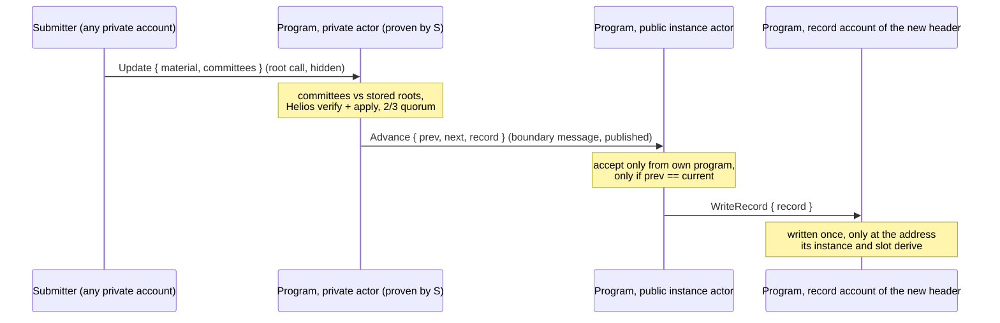

# RFP-021 proposal: Trustless Ethereum State Attestation for LEZ

Status: design final. The build on Helios is in progress; every figure marked ⟨measure⟩ is
filled from its runs on a LEZ `v0.4.0-rc1` node before submission. The team fields marked TODO
are still to fill. The deadline is 10 Nov 2026 (logos-co/rfp README, DD/MM/YY).

Sections follow the fields of the RFP proposal form (`.github/ISSUE_TEMPLATE/proposal.yml`).

Every number here is one of:

- **protocol**: read from LEZ `v0.4.0-rc1` or the Ethereum specification, with the source;
- **derived**: arithmetic from other numbers, shown;
- **measured**: from our own runs, logged in [results.md](results.md);
- **⟨measure⟩**: not yet run on the Helios build.

TODO before submission:

- project and team name, primary contact, team members
- relevant experience, with links to the Logos core and Nimbus verified-proxy work
- milestone payouts and budget
- post-delivery owner
- section 7: confirm the statement-ID and predicate interface

---

## Project summary

RFP-022's bridge, and any LEZ program that acts on Ethereum, needs one primitive: proof that a
fact holds on finalized Ethereum, verified by LEZ itself, with no committee or oracle to trust.

We build that primitive as one LEZ 0.4 program.

- **The consensus logic is Helios's.** The program verifies light-client updates with Helios
  `consensus-core` (a16z), the Ethereum light client whose consensus logic zkSecurity audited
  inside `r0vm-helios` on RISC Zero, the zkVM LEZ runs on. That is the RFP's R.6 asked of us:
  integrate a mature, audited implementation instead of writing a new one (section 11).
- **Updates are proven, not split.** An update carries the sync-committee BLS12-381 aggregate,
  the finality branch and the committee handoff. It runs on a private actor of the program,
  proven by whoever submits it, and lands as **one** transaction. LEZ meters a private
  transaction's proven work at a flat 409,764 exec gas plus its public part (protocol), against
  a check that exceeds one public transaction's 10M cap when run publicly ⟨measure⟩.
- **The module checks the aggregate itself (F.1),** inside LEZ's own execution proof, so no
  second proof system is added.
- **A public path is kept.** The same verifier also runs publicly, split across transactions,
  so anyone can advance an instance with only a consensus endpoint and LEZ gas, and so the
  public cost is measured (P.2, P.8).
- **Consumers attest in their own transaction, publicly or privately.** A private attestation
  keeps the query inside the proof. One message crosses the boundary, a check that the header
  record is held, sent from a one-time alias (F.8).
- **Any finalized block, not just recorded ones,** so the instance needs only two updates per
  sync-committee period. The EIP-2935 history contract reaches the 8,191 blocks before a record,
  a parent-hash chain of headers reaches any block, and beacon `historical_summaries` reach
  further back.
- **The Ethereum side is built by the people who built it.** All fetching and local
  verification go through the Logos Ethereum core module (Nimbus verified proxy), which a
  member of our team developed. That covers the upstream APIs the module still lacks
  (light-client objects, raw `eth_getProof` nodes), the operator daemon and the F.9
  checkpoint-verification API.

---

## Technical approach

### 1. Two things called "light client"

| | Operator's light client | On-chain verifier and state |
|---|---|---|
| What | Logos Ethereum core module (Nimbus `libverifproxy`) on the operator's machine | The program's verifier (Helios `consensus-core`, compiled into its image) plus its instance and record accounts |
| Job | Follow Ethereum, fetch updates, committee keys and inclusion proofs | Decide what LEZ accepts as a finalized Ethereum header |
| Trusted by LEZ | No. It is untrusted data delivery. | Yes. Every LEZ node checks the proof against the image. |

The heavy computation moves to the operator. The trust decision stays on LEZ.

- The proof must be for the deployed program's image, and the program is deployed immutable:
  LEZ v0.4's loader refuses `UpdateHeader` on an immutable header (protocol).
- `Advance` is accepted only from the program's own actor (`from_own_program()`), so it can't
  come from a lenient fork.
- `Advance` is accepted only on top of the store the instance currently holds.

### 2. State

Each **instance** is a public actor of the program. It holds:

- the checkpoint, chain ID, fork schedule and finality parameters, written once at Init and
  never changed (F.9, F.13)
- the current and next sync-committee roots, **32 bytes each**; the 512 keys are never stored
- the finalized beacon header and its execution roots
- its latest record

Its ID is `H(checkpoint ‖ config)`. That makes IDs impossible to squat, and lets several
instances (mainnet, Sepolia, Hoodi) coexist under one program (F.14, F.15).

**Header records** are immutable accounts, 186 bytes of state each:

- the instance, chain ID, slot, beacon root, block number, execution block hash, `state_root`,
  `receipts_root`, and the update's signer count (for consumer policies, section 10)
- at an address derived from the program, the instance and the slot, so anyone can find a
  record and no one holds a key to it
- written once, only by the program, only after a verified update
- never rewritten or removed, so an old statement stays valid forever (R.3), and every action
  reads at most one record (P.9)

### 3. Update: what has to be proven

An update must show all of the following, as Helios checks them (`verify_update`,
`verify_finality_update`):

1. An attested header in the store's period, or the next one once the next committee is known.
2. The sync-committee aggregate signature over it, under the fork's domain.
3. The finality branch from the attested header to the finalized one.
4. The execution-payload branch of each header (Gloas: the execution block hash).
5. At a handoff, the next-committee branch inside the attested state.

On top of Helios, the program enforces three things itself:

- **At least 2/3 of the committee signed.** Helios verifies an update with a single signer and,
  below 2/3, skips applying it rather than refusing it. The program refuses it outright
  (`BelowParticipation`), so a weak update is an error, never a silent no-op.
- **The supplied committees hash to the stored roots.** The instance keeps only 32-byte roots;
  the operator supplies the keys, and the program checks them before building Helios's store
  inside the proof.
- **The update must advance the store.** An already-applied update is refused
  (`AlreadyApplied`, R.8).

A proof of new keys alone is never enough. The new keys are trusted only because the current
committee signed a header containing them:

```
checkpoint → R_N → signs H → H contains R_{N+1} → …
```

Liveness needs at least one handoff per sync-committee period (27.3 h). A missed period stops
the instance, and recovery is a fresh instance (F.10).

### 4. Update path A: proven (the operating mode)



The private fee is (409,764 + public cycles) × base fee + 224,063 × base fee (protocol: LEZ
`v0.4.0-rc1` `PRIVATE_VERIFY_GAS`, `PRIVATE_GAS_STOR`). The proven work isn't metered, so an
update's fee is nearly flat and only its public part varies.

On a LEZ v0.4 node, with live mainnet updates and real proofs, on the reference laptop (M3 Pro,
18 GB, CPU):

| | Handoff update | Finality update |
|---|---:|---:|
| Private cycles | ⟨measure⟩ | ⟨measure⟩ |
| Proving + submit | ⟨measure⟩ | ⟨measure⟩ |
| Peak memory | ⟨measure⟩ | ⟨measure⟩ |
| Public part | ⟨measure⟩ | ⟨measure⟩ |
| Net charge | ⟨measure⟩ | ⟨measure⟩ |

Smaller proof segments trade time for memory; the lowest workable RAM is measured in M0.
GPU proving is measured in M0. **Catch-up:** one private execution can verify several
consecutive periods, so a stalled instance resumes in one transaction (R.7), measured in M1.

### 5. Update path B: public split (fallback and measurement)

- The same verifier runs as public actor messages, spread across blocks. Each step must fit
  `MAX_GAS_EXEC` = 10M, which caps both a transaction's gas limit and a whole block (protocol).
- The split puts the BLS pairing in its own step; the cycle split and the number of steps are
  ⟨measure⟩.
- It needs no prover, so anyone can advance the instance with only a consensus endpoint and LEZ
  gas (F.11, S.7).
- It produces the public numbers for P.2 and the precompile comparison for P.8. A precompile is
  reachable only from public transactions.
- **Both paths write the same header record.** Consumers can't tell which path wrote it.

### 6. Attestation

The consumer program builds the predicate. The user or relayer supplies only the Ethereum proof.
Merkle-Patricia proofs are checked with `alloy-trie`, the same crate `r0vm-helios` uses for its
storage proofs.

- **Public:** the consumer's message to the record account runs on the sequencer: the proof
  check and the predicates. Cost per statement type ⟨measure⟩.
- **Private:** `AttestPrivate` runs on a private actor of the program, inside the consumer's
  private transaction.
  - The query, the Ethereum proof and the predicates are evaluated inside the proof and never
    published.
  - **One message crosses the boundary:** `CheckRecord`, a synchronous call to that record's
    account. The account accepts it only from the program's own actors, only at the address its
    instance and slot derive, and refuses unless it holds that record. It carries the record and
    nothing about the query.
  - **The sender is a one-time alias.** The v0.4 wallet presents a fresh blinded alias for each
    message from a private account (protocol: `lez/wallet/src/account_manager.rs`, `presenter`),
    so the consumer's account is never published and two attestations can't be linked through
    it.
  - **Fees don't link either.** Refunds return to the fee payer's blinded alias, never to a
    public account.
  - **The check can't go stale.** Records are immutable, so a record held when the consumer
    proves is still held at inclusion (R.11).
  - **What is published:** the program, the instance, which record was used, the fee reserve,
    and the time. To keep the record from narrowing down the event, consumers attest against the
    newest record and reach the event's block through history proofs (section 8). What is left
    is "proved after that header", which the submission time already shows.
  - **Evidence (F.8):** after each private step, a publication check lists every published field
    and searches the whole transaction, proof included, for the consumer's accounts, the payer,
    the queried address and slot, and the proof leaves. Results ⟨measure⟩; the full public-state
    diff is M2.
- **Refusals.** v0.4 includes a public transaction that fails and charges its whole gas limit
  (protocol), so a refused public attestation costs several times an accepted one ⟨measure⟩.
  The CLI therefore dry-runs the check before submitting and stops on a refusal, with the same
  typed error the program gives (U.2). A refused private attestation costs nothing: the wallet
  runs the program before proving, so a broken one is never sent.
- **Minimum spec for a consumer's private attestation (P.4):** time and peak memory on the
  reference laptop ⟨measure⟩, with a light desktop load (no second browser): proving shares the
  machine's memory, and starving it multiplies the time.
- **Verified once, used many times.** Attestation never re-verifies an update. It trusts a
  record because only the program writes it, and only after verification.
- **R.11 (independent submissions):** records are immutable and attestation writes no shared
  state. Several private attestations can land in one block, and each can compute its result
  before inclusion.

### 7. Predicates and statements

**Fields:**

- account: balance, nonce, code hash
- storage slot, with offset and width for packed slots
- log: address, topics, data word, topic count, data length

**Values:** uint, int (two's complement), address, bytes32.

**Comparisons:** `= ≠ < ≤ > ≥`, combined with AND over several proofs under one header (soft
#4).

**Helpers:** Solidity mapping-slot derivation.

**Statement IDs carry a nullifier-safety class** (F.6, S.4):

- **Log statements:** ID over `(chain_id, block_hash, tx_index, log_index, log content)`. There
  is one ID per occurrence, so it is safe as a one-shot nullifier.
- **State statements:** ID over `(chain_id, address, slot, value)`. The same state gives the
  same ID, as F.6 requires, so the same value at two different times collides.
  - The docs mark these IDs "unsafe as a one-shot nullifier unless the slot is write-once".
  - The reference vault uses a write-once deposit mapping.

**Reference consumers (U.6):**

- **ERC-20 deposit:** a `Transfer` log to the vault.
- **Native ETH:** the vault's `receive()` emits `Deposit(sender, amount, nonce)`.
  - `msg.sender` is the real sender, including Safe, ERC-4337 and EIP-7702 accounts.
  - No transaction-trie parsing and no secp256k1 recovery sit in the trusted path.

**Typed errors (U.5).** Every refusal is one code, the same in the program, the CLI's dry run
and the docs. Helios's own errors map onto them:

| Failure mode (U.5) | Code |
|---|---|
| Header not finalized | `NotFinalized` |
| Sync-committee signature invalid | `BadSignature`, `BelowParticipation` |
| Committee handoff not verified | `HandoffNotVerified`, `BadCommitteeBranch`, `CommitteeMismatch` |
| Checkpoint stale or wrong | `CheckpointStale`, `CheckpointMismatch` |
| Inclusion proof invalid | `BadInclusion`, `BadExecutionBranch` |
| Predicate not satisfied | `PredicateFalse` |
| Chain-ID mismatch | `ChainMismatch` |
| Malformed input | `Malformed` |
| Update already applied (R.8) | `AlreadyApplied` |

v0.4 blocks record that a transaction reverted but not why, so the dry run is also where a
consumer reads the code.

### 8. Historical state (soft #3)

An attestation can target any finalized block, not only one the instance recorded. That is what
lets the instance run on two updates per period (section 9).

- **Primary, the 8,191 blocks before a record: EIP-2935.** The history contract, live since
  Pectra on mainnet, Sepolia and Hoodi, keeps the last 8,191 block hashes in state. A storage
  proof under the record's `state_root` gives the target's block hash. The target's RLP header,
  which must hash to it, gives its `state_root` and `receipts_root`, and the attestation
  proceeds against those.
- **Fallback, any distance: a parent-hash chain.** The consumer supplies the headers from the
  record back to the target, each checked against its child's `parentHash`, starting from the
  record's execution block hash. It depends on nothing but Ethereum's header hashes, so it also
  covers a chain without EIP-2935 (F.14). The cost grows with the distance, about one keccak and
  600 bytes a block. On the public path that suits short gaps; on the private path the work is
  inside the consumer's proof, which the fee doesn't meter, so it costs proving time only.
- **Older than about 27 h:** beacon `historical_summaries`.
- Cost on both paths, at the record and for a block 1,000 back: ⟨measure⟩.

### 9. Operator daemon (U.3, R.4, R.5, R.8–R.10)

The daemon is a Logos module plus a Logos Core headless CLI.

- It follows Ethereum through the core module and tracks the instance from LEZ events
  (LP-0012).
- **Cadence: two updates per sync-committee period (27.3 h), 642 a year.**
  - the mandatory handoff
  - one about 13.7 h later, so consecutive records stay well inside the 8,191-block history
    window and every block between them can be proven from the later one (section 8)
  - on demand, for an event newer than the latest record, paid by whoever needs it
  - Tracking cost per period: two update charges ⟨measure⟩. There is no heartbeat.
- **Re-check before submit (R.9):** two updates on top of the same store can't both apply, and
  the loser still pays its reserve. The daemon re-reads the instance immediately before sending
  and keeps its reserve tight.
- **Deferral (R.10):** a per-instance randomized delay spreads cost across operators.
  Documented with its effect on latency.
- **Restart (R.4, R.5):** the daemon resumes from the instance on LEZ. It never re-verifies from
  the checkpoint and never repeats work already applied.

### 9b. Operator incentive (soft #5)

Liveness doesn't depend on this. Anyone can still advance an instance by paying the gas. It
gives operators a reason to keep doing so.

- **Pool.** Each instance has a bounty pool: a PDA of the program, seeded by the instance ID.
  Anyone can fund it with an ordinary native-token `Transfer`: consumers, protocols that depend
  on fresh headers, or a grant.
- **Payout.** A successful `Advance` pays the recipient the update names, using
  `custody_transfer` from the pool. The fee program uses the same primitive.
  - The amount is `min(pool, rate × Δslots, cap)`, where Δslots is how far the new finalized
    header is past the previous one.
  - `rate` and `cap` are part of the instance's immutable config.
  - The payout grows with how stale the instance was, measured in Ethereum time, which the
    update itself proves. No LEZ clock read is needed.
- **Why it grows with staleness.** An operator submits once the payout covers its cost.
  Operators with different costs reach that point at different moments, which spreads
  submissions over time instead of starting a race. Frequent tiny updates earn tiny payouts, so
  there's nothing to gain from spamming.
- **Permissionless (F.11).** No registration and no allow-list. Whoever lands the `Advance`
  claims the payout. The `prev == current` check already selects exactly one winner per step.
- **Racing.** A losing submitter still pays its reserve. The bounty doesn't change that, so the
  re-check and deferral of section 9 stay.
- **Attestation fee, optional per instance.** A consumer can add a flat transfer to the pool in
  its own transaction. In a private attestation that is one more boundary crossing. A flat
  amount reveals nothing about the query.
- **Known limits.**
  - The recipient is credited asynchronously, in a later transaction.
  - The payout recipient is public, so a submitter that wants privacy names a fresh account.
  - Funding is voluntary. An unfunded pool pays nothing, and the system behaves as without
    the bounty.

### 10. Security model (S.6, VS.1–VS.6)

- **Fabricated chain (VS.1):** an explicit adversarial test. A self-consistent fabricated chain,
  with a fabricated state root committed through the finalized and attested headers and signed
  by a committee of keys the test holds, must be refused because that committee was never handed
  off from the checkpoint. A control applies the same update to a store that trusts that
  committee, to show the fixture itself is valid.
- **VS.2:** a committee never handed off, a forged next committee, signers one short of 2/3, a
  header not finalized, a tampered state or receipts root, a proof replayed to another chain, and
  a predicate over state the proof doesn't cover: each asserted with its typed error, next to an
  honest control.
- **Committee attack cost.** Following the chain through the sync committee trusts that at
  least 342 of its 512 members are honest. Sync-committee signatures are not slashable today,
  so a dishonest signature costs a member little beyond the reward for that slot. There are two
  ways to get 342 signatures on a header that was never finalized:
  - **Luck.** An entity holding stake share *f* draws seats roughly as Binomial(512, *f*). The
    chance of drawing ≥ 342 seats in one period (27.3 h; 321 periods a year):

    | *f* | P(≥ 342) | P(≥ 410) | P(≥ 461) |
    |---|---|---|---|
    | 0.33 | 6e-55 | 4e-106 | 1e-160 |
    | 0.50 | 1e-14 | 5e-45 | 6e-84 |
    | 0.60 | 9e-4 | 2e-22 | 2e-52 |
    | 0.67 | 0.50 | 1e-11 | 3e-35 |

    Below about 50% of stake this is negligible, even over a year of periods. At 60% it is about
    25% per year at the default threshold. An entity with that much stake can already disrupt
    Ethereum consensus itself.
  - **Bribery.** Each committee is known about a period ahead. An attacker can pay 342 members,
    or the few large operators that control many seats, to sign a false header. The cost is
    whatever those members accept, not stake at risk. We state this plainly. Security for
    high-value consumers comes from the defences below, not from a dollar figure.
- The table is reproducible from the binomial tail:
  `sum(comb(512, i) * f**i * (1 - f)**(512 - i) for i in range(k, 513))`.
- **Consumer defences (VS.4).** Every record carries its update's signer count. A consumer
  chooses its own policy:
  - **A higher participation threshold.** For example, 410 (80%) or 461 (90%). An attacker then
    needs that many seats, which moves the luck columns above by tens of orders of magnitude.
    How often a high threshold costs liveness is measured over a sample of mainnet updates in M1.
  - **The two-committee rule.** Act only on a header that the next committee has also built on.
    An attacker then needs supermajorities in two independently drawn committees: the luck
    probability is squared, and the bribe covers two sets of members.
  - **Value caps** per header or per period, for consumers that need neither.
- **No swappable verification (VS.3):** no `ProgramId` is held in mutable state. Instances are
  immutable. Migration is to a new program version plus a new instance.
- **Immutable deployment.** `from_own_program()` compares program addresses, not code, so the
  program is deployed with `ProgramHeader.immutable = true`. LEZ v0.4's loader then refuses
  `UpdateHeader` on it (protocol: `program_loader/core/src/lib.rs`). Segments and headers are
  write-once, so nothing else in the protocol can change the program. A protocol upgrade of LEZ
  itself is outside this guarantee, and the trust document says so.
- **Config bound to the instance.** The checkpoint, chain ID, fork schedule and participation
  threshold are part of the instance state that `Advance`'s `prev` must match, and part of the
  instance ID. A submitter can't supply a weaker config.

### 10b. Off-chain participants (F.12)

| Participant | What it does | Safety or liveness | If it declines or misbehaves |
|---|---|---|---|
| Checkpoint supplier (whoever runs `Init`) | Picks the weak-subjectivity checkpoint and config | **Safety**, once, at `Init` | A wrong checkpoint gives an instance of the wrong chain. Consumers verify the checkpoint through the core module's API (F.9) before binding to an instance, and a bad instance is never fixed in place, only replaced (F.10, F.13) |
| Beacon API source | Serves light-client updates and committee keys | Liveness | Everything it serves is verified. Any beacon node, ours or public, serves the same data |
| Operator (update submitter) | Proves and submits updates | Liveness | Anyone can submit, with no registration (F.11). The public split path needs no prover, only a consensus endpoint and LEZ gas |
| Execution RPC | Serves `eth_getProof`, headers and receipts | Liveness | Every proof is checked against a verified record. Any archive or full node serves them |
| Consumer's prover (private path) | Proves the consumer's own transaction on the consumer's machine | Liveness, for that consumer only | No third party sees the query |
| Relayer (public path, optional) | Submits a consumer's attestation | Liveness | The consumer can submit it directly |
| Sync committee | Signs headers | **Safety**: the honest-supermajority assumption | Section 10: attack cost and consumer defences |

No participant other than the checkpoint supplier and the sync committee can affect safety, and
each liveness role can be filled by anyone. So no party, alone or as a class, can stop an
attestation from eventually being produced: a consumer who needs a header can fetch the update
and submit it itself.

### 11. Reuse assessment (R.6)

R.6 asks for mature, audited implementations of the light-client protocol and its primitives,
and for what is reused, what is rewritten, and the audit-surface consequence.

**We build on Helios `consensus-core`** (a16z/helios, MIT), the consensus logic of the Helios
Ethereum light client: `verify_bootstrap`, `verify_update`, `verify_finality_update` and
`apply_*`, covering every fork through Fulu and Gloas.

Why Helios, and how we use it, against the alternatives the RFP names:

| | `r0vm-helios` | Helios `consensus-core`, current | Writing our own |
|---|---|---|---|
| What it is | A RISC Zero guest wrapping Helios `consensus-core` 0.8.3, proving for a Solidity contract | The library itself, current release | — |
| Audited | **Yes, by zkSecurity**, at that version | Its logic up to 0.8.3 is the audited one; later changes are not | No |
| Forks | Up to Electra (June 2025) | **Through Fulu and Gloas** | — |
| Verifies today's mainnet (Fulu) | **No** | **Yes** | — |
| zkVM | risc0 2.0 | no zkVM of its own; we pair it with risc0 3.0.5, LEZ's | — |

- **Reused:** Helios's consensus checks, SSZ and BLS through RISC Zero's accelerated
  `bls12_381` and `sha2` forks (the patch set `r0vm-helios` established), `alloy-trie` for
  Merkle-Patricia proofs, `alloy-rlp` for headers.
- **Ours:** the LEZ actor and its trust boundary, the compact store (committee roots, not keys)
  and the 2/3 quorum enforced as an error, the record accounts, statements, predicates and
  statement IDs, history proofs, and the operator and consumer clients.
- **Not usable as is:** `r0vm-helios` itself, which stops at Electra and targets risc0 2.0 and
  an EVM verifier. We take its recipe, not its guest.
- **Audit-surface consequence.** zkSecurity's audit of `r0vm-helios` covers Helios's consensus
  logic as of 0.8.3. Our audit (M5) covers what that audit doesn't: Helios's changes since 0.8.3
  (Fulu, Gloas), our use of it inside a LEZ actor, and all of our own code listed above.
- Cycle cost on LEZ: ⟨measure⟩ (section 4). Helios assembles the signing key from the
  participants' keys; the proving time this costs is measured.

### 12. Dependency check against the live runtime

| Dependency | Status | Our handling |
|---|---|---|
| LEZ testnet 0.4 (S.1) | `v0.4.0-rc1` tagged 29 Oct. The public testnet 0.4 is not live yet | Build and measure on the rc now, on a local v0.4 devnet with a standalone sequencer (S.2). Deploy to testnet 0.4 in M4 once it launches. Re-measure on the final 0.4 |
| SPEL IDL (U.4) | SPEL `v0.7.0-rc.3` supports neither LEZ v0.3 nor v0.4 (spel#291) | Hand-written SPEL-format IDL, with a drift check in CI |
| Logos Ethereum core module | No light-client objects or raw `eth_getProof` nodes | Our team member extends it upstream (U.1, F.9) |
| Standalone sequencer + Bedrock (S.2) | No published Bedrock release matches v0.4's pin | Built from source at the pinned commit; our devnet runs one Bedrock node, the sequencer and the indexer natively. Known issue: the sequencer's Bedrock funding key drains after about 1,350 blocks and must be topped up |
| Helios `consensus-core` on risc0 3.0.5 | `r0vm-helios` ran it on risc0 2.0 | Compiled into our guest with RISC Zero's accelerated forks; the build is in this repo |

---

## Milestones, payout and timeline

TODO: payouts and dates. The total is 8–12 weeks plus the audit.

| # | Milestone | Weeks | Deliverables |
|---|---|---|---|
| M0 | Cost baseline | 1 | Public and proven update numbers on the Helios build, laptop and lowest-RAM numbers, a GPU number on `v0.4`, reviewed with Logos before the build |
| M1 | Verifier and updates | 3 | Helios-based verifier in the program, proven path, public path, Init, instance immutability, VS.1–VS.2 suite through the deployed program, catch-up, decision log |
| M2 | Attestation | 2 | Public and private attest, predicates, statement IDs, history proofs, ERC-20 and native-ETH reference consumers, F.8 evidence with the full state diff, P.4 laptop numbers |
| M3 | Ethereum side and operations | 2–3 | Core module extensions, F.9 checkpoint API, daemon (Logos module plus headless CLI), CLI with dry run and tight gas limits |
| M4 | Testnet and release | 2 | LEZ testnet 0.4 deployment against a public Ethereum testnet (once launched), all benchmarks re-run on the final 0.4, e2e CI on a standalone sequencer, docs, trust-assumptions document, module catalog release |
| M5 | Audit | — | Third-party audit of consensus and inclusion logic, scoped as section 11 says, plus fixes. Allowance TBD. |

---

## Traceability matrix

Every hard requirement maps to a design element and a test or artifact.

| Req | Design | Evidence |
|---|---|---|
| F.1 | Module checks the aggregate in its proven actor, with Helios | Real mainnet updates proven on the node |
| F.2 | Finality branch plus 2/3 participation | Reject-unfinalized and below-quorum tests |
| F.3 | Account, storage and receipt-log MPT, roots bound to the record | Inclusion tests; caller-root-ignored test; tampered proof refused on both paths on the node |
| F.4 | Predicate language (section 7) | Consumer-defined predicate test, no module change |
| F.5 | `chain_id` in instance, record and statement | Same contract on mainnet and Sepolia, cross-rejected |
| F.6 | ID classes (section 7) | Equal-state and distinct-state tests |
| F.7 | Attest inside the consumer's transaction | Reference consumers |
| F.8 | Private attest; one `CheckRecord` crossing from a one-time alias; refunds to the alias | Publication check on the node; full public-state diff (M2) |
| F.9 | Write-once instance; checkpoint API | Immutability test; core-module API |
| F.10 | Fresh instance on staleness | Migration doc plus stale-instance test |
| F.11 | Any account advances (both paths) | Fresh-account test |
| F.12 | Off-chain participants, safety vs liveness (section 10b) | Table in 10b; trust document |
| F.13 | No rewrite instruction | Interface review plus test |
| F.14, F.15 | `H(checkpoint ‖ config)` instances | Mainnet, Sepolia and Hoodi coexisting |
| U.1–U.3 | Logos modules, CLI, daemon | Module catalog, CLI docs |
| U.4 | Hand-written SPEL IDL | Drift check in CI |
| U.5 | Typed errors (section 7) | Error table; the dry run returns the program's code |
| U.6 | ERC-20 and native-ETH consumers | e2e tests |
| R.1, R.2 | Deterministic, read-only attest; dry run before submit | Repeat-verdict test; a refused private attest submits nothing; the CLI stops on a refused public one |
| R.3 | Immutable record accounts | Records written once and read back; post-rotation validity test |
| R.4, R.5 | Daemon resumes from LEZ state | Kill and restart tests |
| R.6 | Helios `consensus-core` (section 11) | Section 11; the build |
| R.7 | Stalled instance resumes; catch-up | Stall test |
| R.8 | `prev == current` check on `Advance` | Racing and replay tests |
| R.9, R.10 | Re-check plus deferral | Multi-operator test |
| R.11 | Immutable records, no shared writes | Same-block private attest test |
| R.12 | CI | Green default branch |
| P.1 | Attest under the per-transaction budget | ⟨measure⟩ |
| P.2 | Per action: cycles, gas, proof time, proof size | results.md |
| P.3 | Amortised tracking cost at the recommended cadence | Two updates per period, results.md |
| P.4 | Laptop and minimum-spec proving | ⟨measure⟩ |
| P.5 | Latency breakdown | No update wait for a block before the latest record; on demand ⟨measure⟩ |
| P.6 | Daemon and prover resources | Report |
| P.7 | Storage growth over 1 and 5 years | 186 B a record, 642 a year: 119 KB a year, 597 KB over 5 (derived) |
| P.8 | In-program vs precompile delta | Report |
| P.9 | No cost scaling with stored state | Every action reads one record account by its derived address |
| S.1, S.2 | Testnet 0.4; e2e on a standalone sequencer | Deployment, CI |
| S.3–S.5 | Integration, consumer-pattern and operator docs | Docs |
| S.6 | Trust assumptions document | Doc (section 10) |
| S.7 | Operator role document | Doc |
| S.8 | Audit | M5, scoped in section 11 |
| S.9, S.10 | Module catalog plus release action | Release |
| S.11 | Decision log | `docs/DECISIONS.md` |
| VS.1–VS.6 | Adversarial suite (section 10) | Native suite, then through the deployed program (M1) |

---

## Decision log (seed entries)

- **D1: Proven update as the operating mode, public split as the fallback.** One transaction
  and no job state; the public split stays for permissionless submission without a prover.
- **D2: Verifier compiled into the program, not an external zk light-client proof.** A LEZ
  program cannot verify an outside receipt inside its own proof, and public STARK or Groth16
  verification is pairing-heavy.
- **D3: Attest trusts records and never re-verifies signatures.**
- **D4: Private attest on a private actor of the program; its only boundary crossing is one
  `CheckRecord` call from a one-time alias.** A cross-boundary state read would publish the same
  and isn't shown on v0.4.
- **D5: Instance ID = `H(checkpoint ‖ config)`.**
- **D6: Statement-ID nullifier-safety classes.**
- **D7: Native ETH via a vault log, not the transaction trie.**
- **D8: Records in write-once accounts derived from the instance and the slot,** carrying the
  block hash and the signer count. An old statement stays valid (R.3), each action reads one
  record (P.9), and consumers can set their own quorum (VS.4).
- **D9: History through EIP-2935, with a parent-hash chain as the fallback.** Two updates per
  period instead of one every few hours. Rejected: our own history on LEZ (a record for every
  reachable block), and beacon `block_roots` (the standard Beacon API doesn't serve those proofs).
- **D10: Two updates per period, plus on demand.** Liveness (the handoff), coverage (records less
  than 8,191 blocks apart), and cost. An event newer than the latest record waits up to 13.7 h,
  or for an on-demand update.
- **D11: Helios `consensus-core` as the consensus logic (R.6).** The audited lineage, current
  through Fulu and Gloas, on LEZ's zkVM. Rejected: `r0vm-helios` as is (stops at Electra, risc0
  2.0, an EVM verifier); writing our own (no audit, a larger audit scope).

---

## Post-delivery plan

TODO: owner. Expect a servicing ask: operate an update daemon for a defined period, inside the
budget.

## Risks

- **Provisional private fees.** `PRIVATE_VERIFY_GAS` is marked `FIXME: Provisional` in LEZ. If
  private work became metered, D1's advantage would shrink. Path B keeps the system working.
- **Latency, for an event newer than the latest record.** About 13 min of Ethereum finality, up
  to 6.4 min for the update to appear, then proving the update ⟨measure⟩, then one block. An
  older event, within 8,191 blocks, needs no update. GPU proving (B10) is the main lever.
- **Operator hardware.** Proving time and peak memory per update ⟨measure⟩. Smaller segments
  trade time for memory; measured in M0.
- **Helios on LEZ's zkVM.** Helios's cost inside a LEZ actor is measured on this build. If the
  key assembly proves too slow, the program supplies decompressed keys as a witness, a change on
  our side of the boundary, not in Helios's checks.
- **Unaudited Helios changes.** Helios's Fulu and Gloas support postdates the zkSecurity audit;
  it is in our audit scope (M5).
- **Testnet 0.4 timing.** The public testnet isn't live yet. Everything up to M4 runs on the rc
  and a local devnet. If the launch slips past M4, the deployment moves with it and the rest of
  M4 is delivered on the devnet.
- **Release-candidate drift.** Every node number is from `v0.4.0-rc1`. The final 0.4 may change
  APIs or the provisional fee constants. Every benchmark is scripted, so re-measuring is a
  re-run, budgeted in M4.
- **Liveness.** A missed handoff stops an instance. Mitigations: multiple operators, alerting,
  on-demand submission, catch-up.
- **A missed mid-period update.** Records can then end up more than 8,191 blocks apart. A block
  in the gap is still reachable through the parent-hash fallback or an on-demand update, so it
  costs latency, not safety.
