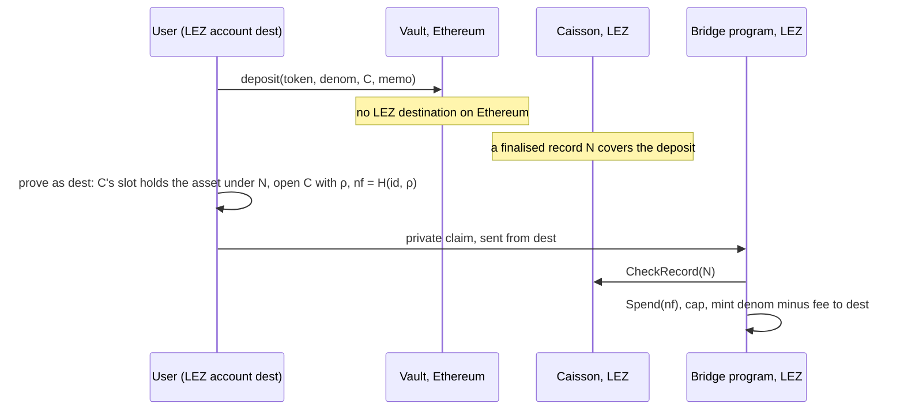
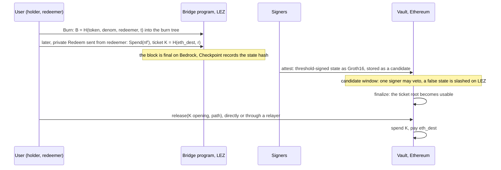

### RFP ID

RFP-022 — Privacy-Preserving Wrapped ERC-20 and Ether Bridge for LEZ

### Your Project Name

Pier

### Team or Organization Name

Congruence Labs

### Primary Contact

Signal: sufialhussaini.17

### Team Members

Member 1
Name or pseudonym: Chirag Mahaveer Parmar
Social links: https://github.com/chirag-parmar
Status: Contractor

Member 2
Name or pseudonym: Shoaib Ahmed
Social links: https://github.com/hu55a1n1
Status: Contractor

Member 3
Name or pseudonym: Vineet Pant
Social links: https://github.com/vineetpant
Status: Contractor

Member 4
Name or pseudonym: Manas Nagaraj
Social links: https://github.com/hopinheimer
Status: Contractor

### Project Summary

A pier is the column a bridge stands on. It rises from the caisson sunk in the riverbed and carries the span across. **Pier** is the bridge that stands on **Caisson**, our RFP-021 attestation primitive ([#277](https://github.com/logos-co/rfp/issues/277)), and carries ERC-20s and native ETH between Ethereum and LEZ in both directions. All code will be released under the MIT and Apache-2.0 licences.

An immutable Ethereum vault escrows deposits in fixed denominations. A LEZ bridge program mints the wrapped token, backed one to one, once a claim proves the deposit through Caisson against finalised Ethereum. Burning on LEZ entitles the holder to release the original from the vault. Neither leg names the other chain's destination, and nothing but amount, token and timing links a deposit to its mint or a burn to its release.

- **Ownership.** A deposit belongs to its destination LEZ account, and only that account can claim it; LEZ's own circuit proves the sender. The random values that open a deposit or a burn are kept on-chain, encrypted to that account like any LEZ private note. There is no seed export and no new key, a leaked value can't steal anything, and hardware wallets work as far as LEZ supports them.
- **Inbound.** The vault writes each deposit's commitment once, to its own storage slot. A claim proves that slot privately as a Caisson Storage fact and keys its nullifier on the fact's statement ID, blinded with a random value.
- **Outbound.** On the way back, a private Redeem on LEZ breaks the link between a burn and its ticket, so what reaches Ethereum carries no secret, anyone can prove it, and one Groth16 check covers a whole batch of releases.
- **Signers.** LEZ v0.4 has no state root and no validity proof, so the outbound leg needs signers; we propose LEZ's own sequencer threshold, the trust Bedrock already uses for withdrawals. Every signer posts a bond, a false state is provable on LEZ and burns it, and one honest signer can veto a false state on Ethereum during a candidate window.
- **Gas.** A private transaction pays its own gas, from the prover's account. A deposit can optionally buy fuel: native LEZ delivered by any operator and repaid from ETH already escrowed.
- **Failsafe.** Refunds need no admin, cover only what a fault stranded, and still work if the fault is in Caisson.
- **Modes.** Private is the default. A fully public path in both directions needs no proving at all. On the private path, one action per direction starts a background job, and proving runs during finality and privacy waits that are longer than it.

LEZ's private DeFi needs assets whose value is already established, and users hold those on Ethereum. If moving them takes a trusted custodian, or leaves a public trail from an Ethereum address to a LEZ account, LEZ's privacy ends where the funds enter.

### Technical Approach

Requirement IDs refer to RFP-022 (F, U, R, P, S, Sec, Priv, Soft). Figures are measured on a LEZ v0.4 devnet unless marked estimated. Source references are LEZ `v0.4.0-rc1` and Bedrock `d480efc`.

#### 0. Where RFP-022 and LEZ v0.4 meet a gap

RFP-022 asks the vault to release on cryptographic verification of a LEZ burn, with no trusted signers or federations. What LEZ v0.4 provides, checked in its source:

| Fact | Where |
|---|---|
| A LEZ block header is `block_id`, `prev_block_hash`, `timestamp` and `hash` (SHA-256 of the whole block). There is no state root | `lez/common/src/block.rs` |
| Each block is inscribed whole on a Bedrock channel, signed by one sequencer key. State is the fold of the final inscriptions; an invalid block is skipped, so validity means executing every transaction | `lez/sequencer/core`; `lez/chain_state/src/chain.rs` |
| Bedrock finality is k blocks deep (k = 120 on testnet, about 1 h), with no finality certificate | `consensus/cryptarchia-engine`; testnet deployment template |
| Checking a leadership proof needs the epoch nonce and two ledger roots, which no header carries | `zk/proofs/pol/src/inputs.rs` |
| Funds leave a zone on threshold Ed25519 signatures of its accredited keys: two thirds of the `sequencer_stake` committee | `mantle/ops/channel/withdraw.rs`; `committee_discovery.rs` |
| `sequencer_stake` slashes only on a two-thirds vote, with no proof of the offence | `lez/programs/sequencer_stake/core/src/lib.rs:312–321` |

So the outbound leg depends on a choice about how Ethereum learns LEZ state. The same question arises for RFP-023 (draft), which inherits RFP-022's approach.

- **What we propose.** LEZ's own sequencer threshold signs the bridge state: the trust Bedrock already applies to withdrawals, and so the security of the LEZ network as v0.4 defines it. We add the accountability v0.4 doesn't provide: bonds, fault proofs checked on LEZ, and a minority veto on Ethereum (§5).
- **What we'd like to agree with Logos in M0.** (1) Whether the sequencer threshold meets F7 and the trust model on v0.4. (2) Whether sequencers would run our signing module, with a bridge bond. (3) Logos's direction on a state commitment in the LEZ header and validity proofs of LEZ blocks.
- **Other paths, for Logos to choose from.** *(a) A bonded attestor set:* anyone may sign by posting a bond, under the same accountability. It resembles an attestor federation, which the trust model aims to avoid, and we state its weaknesses openly: attestors as a class could stall releases while LEZ runs, and admission takes the current set's signatures. *(b) The strict path, with no signers:* Ethereum verifies Bedrock finality and LEZ validity itself. It matches the trust model fully; how much of it lands in this grant depends on what Logos provides and on what the early milestones measure, so it is planned with a decision point (§5).

#### 1. Components

- **Vault** (Ethereum, immutable, no proxy): escrows registered ERC-20s and native ETH in fixed denominations; one write-once slot per deposit; verifies signed LEZ state and pays releases.
- **Bridge program** (LEZ, immutable): claims, mints, burns, Redeems, tickets, checkpoints, nullifiers, caps, fees, bonds and fault proofs, per configuration. It pins one Caisson program and instance.
- **Caisson** (LEZ, our RFP-021 primitive): finalised Ethereum headers and the Storage fact a claim proves. Read only.
- **Off-chain, all Logos modules with headless CLIs**: bridge core module, mini-app and admin UI, and the relayer, fuel-operator, signer and batch-prover daemons.

**Flows.**





**Configurations (F15, F16).** A configuration lives at `PDA(bridge, config_id)`, with `config_id = keccak(chain_id ‖ vault ‖ lez_chain_id ‖ zone_id ‖ bridge_program ‖ caisson_program ‖ caisson_instance ‖ admin_authority)`. Every commitment, nullifier, ticket and signed message binds `config_id`, so nothing valid under one pairing or configuration is accepted under another. The same vault and program deploy unmodified on any EVM chain, mainnet or testnet; only `config_id` differs. Mutable parameters (registry, caps, fees, depth) sit under it, writable only by its own admin. A client lists configurations from their events and switches by `config_id`. Each configuration pairs one EVM chain with one zone, and each chain's token gets its own wrapped mint, so an incident on one chain stays contained to that chain's supply.

**Accounts and storage.** Every object binds `config_id`. Only the configuration's mutable parameters, counters, bonds, freeze flags and the key set are rewritten; everything a claim, Redeem or release relies on is written once and never removed (R4).

| Object | Where | Written | By |
|---|---|---|---|
| Configuration | LEZ, `PDA(bridge, config_id)` | Once; registry, caps, fees and depth by its admin, under fixed ceilings | Deployer, admin |
| Deposit slot `deposits[C]` | Vault, `keccak(C ‖ DEPOSITS_SLOT)` | Once | `deposit` |
| Fuel escrow | Vault, per deposit | Once; repaid once | `deposit`, operator repayment |
| Claim nullifier `nf` | LEZ PDA | Once | Claim, `Refund` |
| Burn leaf `B`, `burn_root[n]` | LEZ burn tree | Each leaf and root once | Burn |
| Redeem nullifier `nf'` | LEZ PDA | Once | Redeem |
| Ticket leaf `K` | LEZ ticket tree | Once | Redeem, direct-ticket burn, `Refund` |
| Checkpoint `state_at[b]` | LEZ PDA | Once | `Checkpoint` |
| Bonds | LEZ, per signer and token | Posted; burned by `Fault` or `FalseDispute` | Signers |
| Mint and release cap counters | LEZ; vault | Each window | Claim; release |
| Key set | Vault | Only through the signed handoff | Signers |
| `candidate[block_id]`, `ticket_root[block_id]` | Vault | Candidate once; final once, after the window | `attest`, `dispute`, `reconfirm`, `finalize` |
| `spent[K]`, `total_in`, `total_released` | Vault | Once; incremented | `release`, `deposit` |
| Freeze flags | Both halves | Set by the freeze authority or by evidence | RFP-002 authority, EV1–EV7 |

**Events** (LP-0012 on LEZ, Solidity events on Ethereum), so relayers, signers and indexers follow the bridge without polling. None carries `dest`, `ρ`, `t`, `redeemer` or `r`; a private claim emits nothing beyond its own transaction.

```
Vault: Deposit(C, token, denom, memo)   Attested(block_id, state)   Disputed(block_id, signer)
       Finalized(block_id, ticket_root)  Released(K, token, denom)   KeySetHandoff(epoch, keys_root)   Frozen(scope)
LEZ:   Burned(B, n, memo)   Redeemed(K, memo)   Checkpointed(b, state)   Fault(signer)   FalseDispute(signer)
       ConfigChanged(config_id, field)   Frozen(scope)
```

#### 2. Deposit (F1, F2, F8, F17)

```
dest  = the LEZ account that will receive the mint and own the deposit (private by default)
ρ     = 32 random bytes
C     = keccak("bridge/deposit/v1" ‖ config_id ‖ token ‖ denom ‖ dest ‖ ρ)
memo  = EncryptedNote to dest's viewing public key: (token, denom, dest, ρ, fuel opening)

vault.deposit(token, denom, C, memo)
  require registered(token, denom), not frozen, deposits[C] == 0
  pull exactly denom            // SafeERC20 and a balance-difference check (USDT); msg.value == denom for ETH
  deposits[C] = keccak("bridge/asset/v1" ‖ token ‖ denom)     // written once, at slot keccak(C ‖ DEPOSITS_SLOT)
  total_in[token] += denom
  emit Deposit(C, token, denom, memo)
```

- **No LEZ destination on Ethereum.** The call, the event and the state hold only `C`, token, denomination and a fixed-length memo. `C` hides `dest` (without `ρ` nobody can test a guess), and the memo uses LEZ's own note encryption (ML-KEM-768), built from `dest`'s public keys alone. Its ciphertexts are assumed not to reveal their recipient, as LEZ's private notes are.
- **The vault records what it received**, and the claim checks the opening against it, so a commitment can't claim more than was deposited.
- **Any Ethereum wallet signs the deposit.** It sees only opaque bytes and holds no bridge secret.
- **Fixed denominations (F8)**, for example 100 / 1,000 / 10,000 USDC, USDT and DAI and 0.1 / 1 / 10 ETH and WETH. Each (token, denomination) is its own anonymity set; final sets are sized from bridge volume.
- **Gas, estimated:** about 80–95k for ETH and 110–135k for an ERC-20, including the encrypted memo (about 1.1 KB); measured in Foundry in M1.

#### 3. Claim on LEZ (F3, F4, F12, R1, R3, R4)

The private claim (the default) is a private transaction **sent from `dest`**, so LEZ's circuit proves control of `dest`, as it does for every private transfer. Inside the proof:

1. A Caisson Storage fact: slot `keccak(C ‖ DEPOSITS_SLOT)` of the vault holds `keccak("bridge/asset/v1" ‖ token ‖ denom)` at block `T`, against a finalised Caisson record `N` (through EIP-2935 or a parent-hash chain when `T` is older).
2. The opening of `C` with `ρ`, read from the memo.
3. `T ≤ N − depth`.
4. `nf = keccak("bridge/nf/v1" ‖ config_id ‖ statement_ID ‖ ρ)`.

Published: `CheckRecord(N)` (the only Caisson message), `Spend{nf}` at a write-once PDA, the cap counter, and the mint of the denomination minus a fixed fee to `dest`.

**F3, met as written:** uniqueness is keyed on the statement identifier the attestation carries, blinded so it never names the deposit.

| Nullifier property | Why it holds |
|---|---|
| One claim per deposit (R3, Sec #6) | Each deposit has one write-once slot, so one statement ID (State class, safe as a one-shot key for write-once state); `deposits[C]` refuses a repeated `C` |
| Unlinkable (Priv #1, #3) | `nf` needs `ρ`, which only `dest`'s viewing key decrypts; a raw statement ID is public data and would name the deposit |
| Theft-proof (Sec #3) | `dest` is sealed in `C` and only `dest` can send the claim; learning `ρ` gives no power |
| Survives a Caisson instance change | `nf` doesn't depend on the instance or record; Caisson gives one fact the same ID across instances |
| Recoverable (F9) | A restored wallet decrypts the memo, recomputes `nf`, and its PDA says whether the deposit was claimed |

- **Atomic and retry-safe.** A rejected claim changes nothing. Caisson records are immutable, so a valid claim never expires (R4).
- **Concurrency, verified in source.** A private transaction's public part runs on live state at inclusion and must reproduce what was proven (`validated_state_diff/mod.rs:374–392`). The bridge sends nothing back into the private part, so claims in one block don't conflict.

**Modes, both directions (F4, F6, Priv #7):**

| Direction | Mode | What links the two ends | User proving | When |
|---|---|---|---|---|
| In | Private claim → private account | Amount, token, timing only | One LEZ private transaction | Default |
| In | Private claim → public account | The same; the balance is visible | One LEZ private transaction | Explicit choice |
| In | Public claim → public account | Fully linked | None: a signed public transaction (P1) | Explicit override |
| Out | Burn, then a private Redeem by the hidden redeemer | Amount, token, timing only | The Redeem, plus the burn if from a private account | Default |
| Out | Public burn with a direct ticket | Fully linked; `eth_dest` hidden until release | None: a signed public transaction | Explicit override |

**Finality (F12).** Recommended inbound default: Ethereum finality, read through a Caisson record. Residual risk: a captured sync committee could sign a forged header (the assumption RFP-021 accepts; at least 10,944 ETH of committee stake, not slashed today). The next committee's record exposes it within about 27 h and freezes claims (EV1), so the mint cap per 27-hour window is set to the loss a deployer accepts. Stricter setting: the two-committee rule, up to about 27 h. Outbound default: Bedrock finality (k = 120, about 1 h on testnet) plus a candidate window of at least 1 h. Every past depth is kept, so a change never invalidates a valid claim.

**Who pays (fuel).** On v0.4 a private transaction pays its fee inside its own proof, from a private account the prover owns (`lez/wallet/src/account_manager.rs:755`); a relayer can submit but can't pay. A deposit can optionally buy fuel: `f` in ETH for a fixed amount of native LEZ. Soon after the deposit, any operator sends a sealed credit to a blinded alias of `dest`, with the alias's opening and recovery binding carried in the memo, and is repaid in wrapped ETH backed by the escrowed `f`. Optional fuel doesn't split the anonymity set:

| Fuel property | Source | Status |
|---|---|---|
| Native LEZ can be credited to a private account; only the native-token program issues a `Credit`, so the bridge can't forge gas | `native_token.rs:66–78` | verified |
| The alias hides the account: `SHA-256(prefix ‖ account_id ‖ opening)`, opening random and in the memo | `program/mod.rs:248` | verified |
| Spending the credit is an unlinkable nullifier that needs the account's secret key | `circuit_io.rs:246` | verified |
| A fuelled claim looks like any other: every private action has one shape, padded to 7 | `circuit_io.rs:470` | verified |
| A credit needs the recipient's recovery binding first, so `Fuel` adds the user's binding | `validated_state_diff/mod.rs:330–336, 528` | verified |
| The operator's signature authorises its transfer inside the bridge's call | `program/mod.rs:379` | to test; fallback: a top-level transfer |

Sized at about 10.5M native units for a claim and a Redeem, from the measured 5,232,864 per private transaction at the floor fee.

#### 4. Burn, Redeem, Release (F5, F6, F7, R2)

```
Burn (LEZ), from a private or public account
  redeemer = the account that may Redeem, by default a private account of the user's;  t = 32 random bytes
  B    = keccak("bridge/burn/v1" ‖ config_id ‖ token ‖ denom ‖ redeemer ‖ t)
  memo = EncryptedNote to redeemer: (token, denom, redeemer, t)
  burn denom; insert B into the burn tree; burn_root[n] written once

Redeem (LEZ, later), a private transaction sent from redeemer
  prove B ∈ burn_root[n];  Spend{ nf' = keccak("bridge/burn-nf/v1" ‖ config_id ‖ t) }
  K = keccak("bridge/ticket/v1" ‖ config_id ‖ token ‖ denom ‖ eth_dest ‖ r)   (r random) into the ticket tree
  memo = EncryptedNote to redeemer: (eth_dest, r);  total_redeemed[token] += denom

Release (Ethereum), by the user or any relayer
  require ticket_root[block_id] finalised, registered, not frozen, within the release cap
  MerklePath(K) → ticket_root[block_id];  require !spent[K];  spent[K] = true
  require total_released[token] + denom ≤ total_redeemed[token]           // inline supply check (EV4)
  pay denom − fixed relayer fee to eth_dest
```

- **The burn names no Ethereum destination (F5)**, and it hides who may redeem. Any account can burn; only `redeemer` can Redeem, so a burn from a public account stays unlinkable once redeemed, and learning `t` gives no power.
- **Public option, direct ticket** (explicit override): a public burn may write `K` at once, with no Redeem and no proving. `eth_dest` stays hidden until release; the burn and the release are linked.
- **Who proves what.** The user proves only ordinary LEZ private transactions (claim, Redeem, and a burn from a private account). The Groth16 proof Ethereum checks wraps public signatures, so anyone can make it, and one proof covers a batch. No x86-only step reaches the user's machine. Each release costs a Merkle path, about 60–90k gas estimated.
- **Cost.** The private way back asks the user for one more LEZ private transaction, at LEZ's usual cost (about 15 min on a CPU laptop), in return for no secret-bearing proof on Ethereum, no x86 step for the user, and cheap releases. It runs in the background (§9). We considered unlinking at release with a small user proof wrapped by a relayer instead, and didn't choose it as the default: it sends a secret-bearing proof to Ethereum, adds a Groth16 verification to every release, and running both paths would split the outbound anonymity set.

#### 5. How Ethereum learns LEZ state (F7)

```
Checkpoint{b}       anyone; a public transaction declaring block_window(b..b+1)
  state_at[b] = H(ticket_root ‖ total_redeemed[·] ‖ freeze_flags)    (write-once)

Signed message      msg = H("lez/bridge-state/v1" ‖ zone_id ‖ bridge_program ‖ config_id ‖ block_id ‖ state)
                    signed by a threshold m of the key set, only for checkpointed blocks final on Bedrock

Vault               attest(state, proof)      Groth16 of the threshold check (RISC Zero guest, audited verifier, pinned)
                                              → candidate[block_id]
                    dispute(block_id, sig)    any one signer's secp256k1 veto, within the window
                    reconfirm(block_id, proof) n − 1 of n reinstate a vetoed candidate
                    finalize(block_id)        after the window: ticket_root[block_id] usable

LEZ                 Fault{msg, sig, signer}            msg's state ≠ state_at[block_id] → burn the signer's bonds
                    FalseDispute{dispute, sig, signer} vetoed state = state_at[block_id] → burn the vetoer's bonds
```

- **Bonds.** LEZ's `sequencer_stake` can't slash on evidence: a slash "carries no proof the offence happened" and needs a two-thirds vote (`lez/programs/sequencer_stake/core/src/lib.rs:312–321`). So each signer bonds wrapped tokens per registered token, with bond ≥ release cap over the release delay ÷ m. A false state costs its signers at least what it could release, and burning the bonds takes that value back out of the wrapped supply, restoring the backing. A newly registered token's releases finalise only once enough signers hold bonds in it.
- **Candidate window and minority veto.** Ethereum can't tell a false state from a true one, so each signed state waits. During the window one honest signer stops a false state with no admin; a veto of a true state is provable on LEZ and slashed; two conflicting signed states freeze releases (EV5). If every signer colludes, the release cap bounds the loss and the bonds restore it. A per-token release delay, set by the admin, can be added on top of the window (Soft #3).
- **Key-set changes (Sec #8).** The vault accepts a state signed by a threshold of the key set it tracks, and a new key set only through a handoff signed by a threshold of the current one. That rule is fixed at deployment, as Caisson follows sync-committee handoffs under a fixed rule.
- **Path (a)** uses the same message, vault, bonds and fault proofs with a different key set; anyone may join by bonding.
- **Path (b)** removes the signers: a Bedrock light client on Ethereum (leadership proofs are BN254 Groth16, checkable with Ethereum's precompiles, once the header carries the epoch nonce and ledger roots or the ledger is proven) and a RISC Zero proof of LEZ block execution committing to the ticket root. Under it, inbound and the LEZ side of outbound ship complete, a validity-path milestone measures the prover per block and ends in a decision point with Logos, and the vault is deployed once its release verifier is final (or deployed without release first, with a successor adding it, per §7).

#### 6. Privacy (Priv #1–#7, F8)

The linkage test of a round trip (M3) checks unlinkability on public data.

| Signal | Why it remains | What an observer learns | Mitigation, on by default (U5) |
|---|---|---|---|
| Amount | Ethereum transfers are public | The (token, denomination) set | Fixed denominations; fees fixed per denomination |
| Timing | Transactions are timestamped | Ordering within the set | Finality wait plus a suggested delay; claims never expire |
| Record used | A claim names a finalised record | "Deposited before N" | The proof hides which slot |
| Burn root used | A Redeem names a root | "Burned before n" | Every earlier burn stays in the set |
| Fee payer | Someone pays gas | Nothing: paid inside the proof | Fuel for first-time users; padding |
| Fuel | Delivered in the open | That a deposit bought fuel | Unlinkable to the claim |
| Split amounts | Several deposits close together | A cluster | Independent random delays per claim; a warning |
| Relayer's view | It submits | A finished proof, its time, the user's IP | Switchable per operation; IP is out of scope and disclosed |
| Public mode | The user chose it | The exact deposit or burn | Explicit confirmation |

**Anonymity set:** for a claim against record `N`, the unclaimed deposits of the same token and denomination before `N − depth`; for a release, the unredeemed burns of the same token and denomination before the root the Redeem used. The mini-app shows the set size before the user acts. A failed transaction reveals nothing new: the block records only its index among reverted transactions (`lez/common/src/block.rs:62`), and only the fee action settles (Priv #5). No component but the user's own wallet sees anything that links the legs (Priv #4): the Ethereum wallet sees opaque bytes, relayers a finished proof, the fuel operator an alias already public, provers public signatures. The docs and each step of the mini-app show what is public and what is private on both chains (U7).

#### 7. Keys, recovery, registry, caps, fees, freeze, failsafe

- **Ownership and recovery (F9, R5).** A position belongs to a LEZ account: a deposit to `dest`, a burn to its `redeemer`. Recovery: restore the wallet from its seed (which regenerates its accounts), trial-decrypt the vault's and the bridge's fixed-length memos with the accounts' viewing keys (a view tag speeds the scan), then check nullifiers and `spent[K]` and finish what is open. That is the construction the RFP prefers: claim data regenerated from on-chain events the user's own keys can scan for. A dedicated bridge account's viewing key discloses only bridge activity (Soft #2).
- **Why not seed-derived secrets.** Bridges of this kind commonly derive a bridge key from the seed. We rejected it: the LEZ wallet gives modules only public keys (`core_ffi`), so the seed or a derived key would have to leave the wallet; its secrets would be bearer secrets, so a leak could steal unredeemed burns; and it fails with hardware wallets, since Keycard keeps the seed on the card (`load_lee_key`) and supports public accounts only today. With account-bound ownership, public claims and burns sign on the card now, and private ones follow when LEZ extends the card to private accounts, with no change to Pier.
- **Registry (F10, F17).** Per token: address, wrapped mint (LP-0013, ATA-compatible), decimals, denominations, caps. USDC and USDT (6 decimals), DAI and WETH (18), and native ETH as its own entry. The wrapped mint keeps the token's decimals, so registration refuses anything not exactly representable. Delisting stops deposits only; a removed denomination stays claimable and burnable; a new one starts an empty anonymity set. The deployer guide documents each registration change and its effect on users.
- **Caps (F11, Sec #4).** Rolling mint caps on LEZ and release caps on the vault, per token and global. The mint window is about 27 h (how long the next sync committee's record takes to expose a forged header); the release window covers the candidate window and release delay. Default values are set in M0, from current bridge volume and the bond sizes. A configuration may raise a cap for a Caisson record backed through Caisson Stake, sized to the filled stake and only while the record's coverage runs (until its deadline); it never requires backing.
- **Fees (F13).** In the wrapped token, so the fee stays within the bridged asset and the user needs no separate LEZ balance, through the RFP-001 fee switch, mint and burn set independently. Initial rate 0 on testnet; recommended production start 10 bps; range 0–100 bps, with the ceiling fixed per configuration at deployment. Each rate is rounded to a fixed amount per (token, denomination), so it can't fingerprint; the mint fee is taken at claim and the burn fee at burn, so amounts stay on the grid. Routing: treasury, relayer, and optionally Caisson's operator tip, so bridge traffic pays for fresh records. The fuel price `f` is separate, and not a fee.
- **Freeze (F14, Sec #5).** The RFP-002 freeze authority pauses minting or redemption, globally or per token, on each half independently. Evidence freezes need no admin (table below). The freeze works at token and protocol level only, as a consequence of the privacy design.
- **Immutability and migration (Sec #8).** Both halves are immutable, with no proxy, and Caisson is pinned in `config_id`. A new version is a new pair; old wrapped tokens keep redeeming from the old vault, and no escrow moves between vaults. Adopting value commitments (Soft #1) is such a new version, or, if built in from the start behind a switch, needs no redeployment (a team decision).
- **Failsafe (Sec #9).** A refund is decided on LEZ, where the nullifiers live, and paid on Ethereum against the vault's own record. `Refund` is sent from `dest`, opens `C`, writes the same nullifier a claim would (so a deposit is never both claimed and refunded) and issues `K_r = keccak("bridge/refund/v1" ‖ config_id ‖ C ‖ eth_addr)`; the vault pays it against `deposits[C]`. It needs no Caisson, so it works when the fault is in Caisson. It acts only on what the fault stranded: a freeze names its scope (the configuration or one token), and a refund must fall inside it. Refunds count against the release cap. If the fault is in the outbound verification itself, the failsafe is stop-only: escrow stays locked and no admin can move it.

| EV | Trigger | Submitted by | Effect | Why it is sound |
|---|---|---|---|---|
| EV1 | Caisson froze the pinned instance | Anyone | Claims stop; scope: the configuration | Only valid evidence writes Caisson's Freeze account |
| EV2 | More minted than the vault received | Anyone | That token freezes | Every honest claim proves a deposit before its record |
| EV3 | A backed record proven false, once Caisson Stake's false-header challenge exists (future work in RFP-021) | Anyone | The configuration freezes | The challenge is a proof |
| EV4 | More released than redeemed | Inline, every release | That release refused | Checked by the vault itself |
| EV5 | Two conflicting signed states | Anyone, on Ethereum | Releases stop | Two states for one block prove the threshold lied |
| EV6 | A false signed state | Anyone, on LEZ | Signer's bonds burned; Redeems and checkpoints stop | Compared with LEZ's own checkpoint |
| EV7 | One signer's veto | A signer, on Ethereum | The candidate is held; a false veto is slashed | Reinstated only by n − 1 |

| Where the fault is | Unclaimed deposits | Burned, not yet released | Wrapped tokens in circulation |
|---|---|---|---|
| Caisson, or the claim's verification | Refunded, scoped to the freeze | Releases continue, or the freeze authority pauses them | Possibly partly unbacked; bounded by mint caps, visible through EV2 |
| The bridge program on LEZ | Refunded, scoped to the freeze | Paused by the freeze authority; tickets under signed states stay valid | As above |
| Outbound verification (signers, the Groth16 guest, the vault's release) | Stop-only: escrow stays locked, a new version is deployed, nothing can be moved by an admin | | |

#### 8. Security

Pier's safety rests on Ethereum's sync committee for the way in and on the signer threshold for the way out, each bounded by caps, freezes and, outbound, bonds and a veto. Every other party affects liveness only. This section states the assumptions and the participants, then maps the ways bridges have lost funds to where each could reach Pier, with the tests that cover it (Sec #2, #3, #6, #7).

##### Trust assumptions (Sec #7)

| Assumption | If it fails | Bounded by |
|---|---|---|
| **At least 2/3 of the sync committee is honest**, through Caisson | A false deposit record; wrapped tokens minted without backing | Depth; mint caps per 27-hour window; EV1 and EV2; the optional two-committee rule |
| **The signer threshold doesn't collude** (proposed: LEZ's sequencer threshold, the trust v0.4 already places in it) | A false ticket root releases escrow | One honest signer's veto in the candidate window; bonds burned on LEZ; release caps (§5) |
| **The prover and verifiers are sound** | A false claim, Redeem or signed state verifies | Pinned RISC Zero versions and its audited Groth16 verifier; both halves immutable, so a fix is a new version (Sec #8) |
| **The configuration is deployed correctly** | The bridge pairs the wrong chain, vault or Caisson instance | `config_id` binds every parameter, fixed at deployment; clients check it before use |
| **The token issuer doesn't blacklist the vault** | That token's escrow is stuck | Documented; it affects every holder of that token alike |
| **LEZ and Bedrock are live** | Claims, Redeems and checkpoints are delayed or censored | Liveness only: claims never expire and tickets stay valid |

##### Participants (R9)

| Participant | Does | Affects | If it declines or misbehaves |
|---|---|---|---|
| Deployer | Sets the configuration and the fee ceiling | **Safety**, once | Clients check the configuration; a bad one is replaced by a new pair |
| Admin and freeze authority (RFP-001, RFP-002) | Registry, caps, fees under the ceiling; pauses | Liveness, fees | Can't mint, move escrow, exceed the ceiling or change verification |
| Sync committee, through Caisson | Signs Ethereum headers | **Safety**, inbound | Bounded as above |
| Signers | Sign checkpointed LEZ state | **Safety**, outbound | Bounded as above; a false veto is slashed. If all stop, releases wait and tickets stay valid; under the proposed design, that is LEZ itself stopping |
| Caisson operator | Advances Caisson | Liveness | Anyone can, for Caisson's operator tip; older deposits stay claimable |
| Relayer | Submits claims, Redeems and releases | Liveness | Another relayer, or self-submission |
| Fuel operator | Delivers gas to a fuelled deposit | Liveness | Any operator, or fund the account another way |
| Batch prover | Proves signed states for Ethereum | Liveness | Anyone; it needs no secret |
| RPC, sequencer, indexer | Serve reads and take submissions | Liveness; sees the user's IP | Switch endpoint (U9); daemons resume from chain state |

Only the deployer, the sync committee and the signers affect safety, and the last two are bounded on-chain. Every liveness role can be filled by anyone, the user included.

| Component that handles user data (Priv #4, #6) | What it sees | Can it link the legs? | Switchable? |
|---|---|---|---|
| The user's LEZ wallet | Every key and decrypted memo | It is the user's own control | |
| Ethereum wallet signing the deposit | `C`, token, amount, the encrypted memo | No | Any wallet |
| Relayer | A finished proof or ticket opening, its time, the user's IP | No | Per operation, or self-submit |
| Fuel operator | An alias already public on Ethereum | No | Any operator, or fund another way |
| Batch prover, signers | Public signatures and public state | No | Anyone can prove |
| RPC, sequencer, indexer | Queries and the user's IP (out of scope, disclosed) | Network metadata only | Yes (U9) |

##### Threats, drawn from bridge exploits

Every major bridge loss, including those in the RFP's appendix, falls into one of the first ten classes; the last two are specific to Pier's bonds and fuel, and to its privacy. Each refusal test asserts its code (§9) and runs next to an honest control that passes.

| Class | Bridge incidents | Where it could reach Pier | Tests |
|---|---|---|---|
| **A1. Signer set compromised** | [Ronin](https://rekt.news/ronin-rekt), 2022, ≈ $624M, 5 of 9 keys; [Harmony](https://rekt.news/harmony-rekt), 2022, ≈ $100M, 2 of 5; [Multichain](https://www.certik.com/blog/multichain-collapse-the-private-key-leak-that-drained-usd125m), 2023, ≈ $126M; [Orbit](https://www.coindesk.com/business/2024/01/02/orbit-chain-loses-81m-in-cross-chain-bridge-exploit/), 2023, ≈ $81M | Outbound signers; inbound has none | **A1.1** a state signed below threshold → `VerificationFailed` (603)<br>**A1.2** a false state signed by the threshold, held by one veto<br>**A1.3** `Fault` on LEZ burns the signers' bonds<br>**A1.4** two conflicting signed states → `Frozen` (606), EV5<br>**A1.5** every signer colluding: releases stop at the cap → `CapExceeded` (602)<br>**A1.6** a key-set handoff below threshold → `VerificationFailed` (603) |
| **A2. Signature check bypassed** | [Wormhole](https://rekt.news/wormhole-rekt), 2022, ≈ $326M, a spoofed account let a fake guardian set through | The Ed25519 threshold check in the guest; the Groth16 verifier; the secp256k1 veto | **A2.1** one bit flipped in a signature<br>**A2.2** a signature over another configuration's message<br>**A2.3** a key outside the tracked set, or one signer counted twice<br>**A2.4** a non-canonical or small-order Ed25519 signature (`verify_strict`)<br>**A2.5** a tampered Groth16 proof or wrong public inputs; each → `VerificationFailed` (603) |
| **A3. Inclusion proof forged** | [BNB Token Hub](https://blog.verichains.io/p/vsa-2022-101-iavl-spoofing-attack), 2022, 2M BNB minted; [Dragonberry](https://forum.cosmos.network/t/cosmos-sdk-ibc-vulnerability-retrospective-security-advisories-dragonberry-and-elderflower-october-2022/8735), 2022, no loss | The deposit slot's storage proof through Caisson; burn and ticket paths | **A3.1** Caisson's Merkle-Patricia tamper suite, run through a claim → `InvalidInclusionProof` (200)<br>**A3.2** a forged slot value, or the wrong vault or slot → `ConditionUnsatisfied` (201)<br>**A3.3** a burn path to a root never written: no proof<br>**A3.4** a tampered ticket path → `VerificationFailed` (603) |
| **A4. Fabricated source state** | [NEAR Rainbow Bridge](https://decrypt.co/108015/nears-rainbow-bridge-blocks-another-attack-costing-hackers-5-ethereum), 2022, no loss, fake blocks caught by watchdogs | A deposit under a header not yet deep enough; a LEZ state not yet final | **A4.1** a deposit newer than `N − depth` → `InsufficientDepth` (604)<br>**A4.2** a release on a candidate still in its window, or never attested → `RootNotFinal` (609)<br>**A4.3** a vetoed candidate finalised without `reconfirm` → `RootNotFinal` (609)<br>**A4.4** a claim against a frozen Caisson instance → `InstanceFrozen` (300), EV1 |
| **A5. Bad initialisation or upgrade** | [Nomad](https://rekt.news/nomad-rekt), 2022, ≈ $190M, an upgrade trusted a zero root; Ronin, 2024, an upgrade skipped an initialiser | Deployment, configuration, key set | **A5.1** zero or default configuration fields refused at deployment<br>**A5.2** the vault has no proxy and no upgrade entry (bytecode check)<br>**A5.3** a second configuration under one `config_id`<br>**A5.4** a release against a zero root → `RootNotFinal` (609) |
| **A6. Privileged entry reached** | [Poly Network](https://rekt.news/polynetwork-rekt), 2021, ≈ $611M, a message called the keeper manager; [Socket](https://www.coindesk.com/id/tech/2024/01/17/socket-bungee-restart-operations-after-apparent-33m-exploit), 2024, ≈ $3.3M, arbitrary calls | Admin calls, the mint authority, fee and freeze settings, `Refund` | **A6.1** each admin call from a non-admin, or another configuration's admin → `Unauthorized` (612)<br>**A6.2** a mint reached other than by a valid claim<br>**A6.3** a fee above the ceiling → `Unauthorized` (612)<br>**A6.4** a refund outside the freeze's scope → `OutsideFreezeScope` (611)<br>**A6.5** a review that nothing received from LEZ changes keys, registry or verification |
| **A7. Replay** | [Polygon Plasma](https://immunefi.com/blog/bug-fix-reviews/polygon-double-spend-bugfix-review-2m-bounty/), 2021, no loss, one exit replayable 223 times | Claims, Redeems, tickets, refunds, chains, configurations | **A7.1** a claim twice, and two claims racing in one block → `AlreadySpent` (605)<br>**A7.2** a Redeem twice, and a ticket released twice → `AlreadySpent` (605)<br>**A7.3** a refund after a claim, and a claim after a refund → `AlreadySpent` (605)<br>**A7.4** a claim proven under another configuration or chain → `WrongConfig` (608), `WrongChain` (202) |
| **A8. Deposit accounting** | [Qubit](https://www.merklescience.com/blog/hack-track-analysis-of-qubit-finance-exploit), 2022, ≈ $80M, deposit events without a lock; Meter.io, 2022, a wrapped-token path skipped the transfer; [THORChain](https://blog.thorchain.org/post-mortem-eth-router-exploits-1-2-and-premature-return-to-trading-incident), 2021, ≈ $8M, a contract in front of the router | The vault's intake | **A8.1** a fee-on-transfer or short transfer, and `msg.value ≠ denom` → `InvalidDenomination` (601)<br>**A8.2** an unregistered token or denomination → `UnsupportedToken` (600)<br>**A8.3** a repeated `C` → `AlreadySpent` (605)<br>**A8.4** a claim for more than was deposited → `ConditionUnsatisfied` (201)<br>**A8.5** a deposit through a contract in front of the vault: only the vault's own slot counts |
| **A9. Prover unsound** | RISC Zero [CVE-2025-52484](https://advisories.gitlab.com/cargo/risc0-zkvm/CVE-2025-52484/) and [CVE-2025-61588](https://advisories.gitlab.com/cargo/risc0-zkvm-platform/CVE-2025-61588/), 2025, no loss | Every private step and the Groth16 wrap | **A9.1** the build fails on a RISC Zero version below both fixes<br>**A9.2** a dev-mode receipt refused<br>**A9.3** the verifier's parameters checked against the prover's, in CI |
| **A10. Liveness lost** | [Multichain](https://decrypt.co/147622/126m-multichain-funds-abnormally-moved-unknown-address-says-project), 2023, operations stalled while one person was unreachable | Signers, relayers, operators, Caisson | **A10.1** every signer stopped, then restarted: tickets stay valid and release<br>**A10.2** a relayer killed mid-flow: the job resumes, nothing submitted twice (R7)<br>**A10.3** Caisson stalled: older deposits claim, newer ones wait → `RecordPending` (700)<br>**A10.4** RPC and sequencer switched mid-flow (U9) |
| **A11. Bond, veto and fuel abuse** | No incident yet | Bonds, vetoes, fuel repayment | **A11.1** a veto of every true state: each slashed by `FalseDispute`, reinstated by n − 1<br>**A11.2** a `Fault` or `FalseDispute` without a mismatch → `NoFault` (610)<br>**A11.3** a bond withdrawn while a state it signed is a candidate<br>**A11.4** a fuel operator repaid twice → `AlreadySpent` (605) |
| **A12. Linkage** | No incident; the privacy goal itself | Public data on both chains | **A12.1** the full event and state diff of a round trip shows no destination<br>**A12.2** a linkage classifier at chance over a round trip<br>**A12.3** refused and accepted claims indistinguishable on chain (Priv #5)<br>**A12.4** no error carries a commitment, slot, nullifier or destination (U8) |

Alongside the classes: stateful invariant fuzzing of the vault (wrapped supply ≤ escrow; one release per ticket; one refund per deposit; no release on an unfinalised root; caps hold), under random deposit, claim, burn, Redeem, release and refund sequences; symbolic checks of `release`, `refund`, `finalize`, `dispute` and the handoff; property tests of the guest logic.

##### Testing plan

Native tests run first; from M1 the same suite runs through the deployed vault on a Kurtosis Ethereum devnet and the program on a standalone sequencer, in CI (R10).

| Class | Today | Milestone |
|---|---|---|
| A1, A2 | | M2 |
| A3 | Caisson's prototype refuses tampered roots and proofs; the private storage attestation is measured | M1 (claims), M2 (paths) |
| A4 | Caisson's prototype refuses unfinalised headers | M1, M2 |
| A5, A6 | | M1, M2, M3 (refund scope) |
| A7 | Statement IDs and chain binding in Caisson's prototype | M1, M2, M3 |
| A8 | | M1, with USDT on a mainnet fork |
| A9 | A verifier-parameter mismatch found and fixed in Caisson's attestation experiment | M1 (CI) |
| A10 | | M3, M4 |
| A11 | | M2, M3 |
| A12 | Revert visibility checked in the LEZ source | M3 |
| Invariants, symbolic checks | | M1, M2 |

The external audit, remediated in M5, covers the vault, the bridge program and these tests; its report is published.

#### 9. Modules and usability (U1–U10)

- Bridge core module (deposit, claim, burn, release, recover, refund, registry read and admin), on the LEZ module, the Logos Ethereum core module with its verified proxy, and the wallet SDK. It holds no secret.
- **One action per direction (U5).** "Bridge in" and "Withdraw to 0x…" each start a background job: it proves the claim once the Caisson record exists and submits after the privacy delay; it burns, proves the Redeem, submits, and a relayer releases. A job resumes after a restart, and an interrupted one has submitted nothing (R7). The app shows an arrival time, not a proof time. Fixed denominations, a suggested delay, a permissionless relayer and a private account are pre-selected.
- **Proofs made early stay valid.** LEZ accepts any commitment root its tree has ever had (`root_history`, `lee/state_machine/src/state/mod.rs:623–626`), and records and burn roots are written once, so proving overlaps the waits.
- Mini-app (deposit and redemption end to end, recovery, registry with caps and utilisation, a leak indicator, private pre-selected) and admin UI; daemons as Logos modules with headless CLIs, with configurable finality depth, structured logs, a clean shutdown and a documented operator journey (install, configure, run, monitor) (U3); events through LP-0012; a hand-written SPEL IDL with a drift check (U4); errors with one code per failure mode, revealing no deposit or burn (U8); switchable endpoints (U9); our own module catalog with the release action (U10, S3).
- **Errors (U8).** One code per failure mode, in the crate Caisson's program and module share, outside Caisson's bands (6xx bridge program and vault, 7xx module); no message carries a commitment, slot, nullifier or destination, so no error says which deposit or burn it concerned.

| Failure mode | Code | Raised by |
|---|---|---|
| Unsupported token | `UnsupportedToken` (600) | Vault, claim |
| Invalid amount | `InvalidDenomination` (601) | Vault, claim, burn |
| Cap exceeded | `CapExceeded` (602) | Claim, release |
| Verification failure | `VerificationFailed` (603), or Caisson's code | Prover, vault |
| Insufficient finality | `InsufficientDepth` (604) | Prover, vault |
| Already claimed or used | `AlreadySpent` (605) | Deposit, claim, Redeem, release, refund |
| Frozen | `Frozen` (606), `TokenFrozen` (607), Caisson `InstanceFrozen` (300) | Both halves |
| Wrong configuration | `WrongConfig` (608) | Claim, release |
| Ticket root not final | `RootNotFinal` (609) | Vault: release |
| Fault proof without a mismatch | `NoFault` (610) | `Fault`, `FalseDispute` |
| Refund outside the freeze's scope | `OutsideFreezeScope` (611) | `Refund` |
| Not this configuration's admin, or beyond a fixed ceiling | `Unauthorized` (612) | Admin calls |
| Deposit newer than the latest record | `RecordPending` (700) | Module |
| Ticket root still in its candidate window | `CandidatePending` (701) | Module |

The module also returns Caisson's `4xx` codes for source and proving failures. Claims, Redeems and refunds refuse inside the prover, so a refusal there means no proof and nothing submitted; every other step refuses on the sequencer or the vault and reverts. Codes are append-only.

- **Common Ethereum wallets (Soft #5).** Basecamp prepares the whole deposit and the user signs it in their own wallet through WalletConnect or a QR code; every bridge secret stays in Basecamp, and an ERC-7730 descriptor gives Ledger clear signing. We rejected deriving secrets from a wallet signature (phishable, and fails for smart-contract wallets).

#### 10. Performance (P1–P7)

Measured on a LEZ v0.4 devnet with real proofs (Apple M3 Pro, 18 GB, CPU proving, base fees at the floor of 8), or on recorded mainnet in RISC Zero, unless marked estimated.

| Req | Item | Time | Space |
|---|---|---|---|
| P1 | Private claim core: a complete private storage attestation | 14.6 min proving | 7.3 GB peak; receipt 224,063 B on chain (storage gas); 409,764 exec gas; charged 5,232,864 |
| P1 | Claim of an older deposit (history inside the proof) | 5,238,752 cycles whatever the distance | Same charge: only `CheckRecord` is published |
| P1 | Public claim: storage check | 270,062 cycles; one block | Public attestation 7,520 B, about 301,509 exec gas |
| P1 | Public check, 1,000 blocks back (EIP-2935) | 3,288,376 cycles, 397k exec gas | Charged 4,504,320 |
| P1 | The bridge's own claim logic (opening, `nf`, mint) | A few accelerated Keccak hashes (estimated; measured in M1) | Three account writes |
| P2 | Caisson tracking, shared by every consumer | Two updates a period | 429,723 exec + 224,063 storage gas each; about 11.2M native units a period; per deposit, that divided by the period's deposits (about 112k at 100) |
| P2 | Redeem, `Fuel`, `Checkpoint`, `Fault` | Redeem about as a claim; `Fault` one Ed25519 check, under 1M cycles with acceleration (estimated; measured in M2) | One receipt each for the private ones |
| P3 | Deposit | | ETH about 80–95k gas, ERC-20 about 110–135k, including a 1.1 KB memo (estimated) |
| P3 | Release | | About 60–90k gas: a Merkle path, no proof (estimated) |
| P3 | `attest` / `finalize` / `dispute` | Once per batch / once per batch / rare | One Groth16 check (measured in M2) / about 50k / about 40–60k gas (estimated) |
| P4 | User proving, claim or Redeem | 14.6 min (M3 Pro) | 7.3 GB peak; declared minimum 16 GB. A mid-range laptop and the minimum, Linux and macOS, measured in M0 |
| P5 | Latency in | Ethereum finality 13–19 min + a Caisson record (none if older; else about 48–56 min) + the privacy delay; the claim proof overlaps them | |
| P5 | Latency out | Privacy delay (the Redeem proof overlaps it) + Bedrock finality about 1 h + candidate window at least 1 h (estimated) | |
| P6 | Caisson operator | 35.6–36.7 min per update, two a period; 30 s on a GPU | 8.4–8.7 GB; 3.9 GB at a smaller segment size |
| P6 | Batch prover, relayer, fuel operator, signer | Measured in M4 | Measured in M4 |
| P7 | Ethereum state | | One 32-byte slot per deposit (two if fuelled), one per release, one per batch: about 64 MB of slot values at 1M deposits and 1M releases, 640 MB at 10M (estimated) |
| P7 | LEZ state | | One nullifier PDA per claim and per Redeem, burn and ticket leaves, one checkpoint per signed block; Caisson records 226 B each, 145 KB a year; storage gas is charged on transaction bytes. Account sizes measured in M3 |

GPU proving cut Caisson's update proof from 1,107 s on an M3 Max CPU to 30 s on an RTX 4090; which laptop GPUs RISC Zero supports is checked in M0.

#### 11. Dependencies

- **RFP-021: Caisson**, our proposal ([#277](https://github.com/logos-co/rfp/issues/277); repository [github.com/congruence/caisson](https://github.com/congruence/caisson)), as the base. Pier needs from any RFP-021 primitive only a finalised storage-slot statement with a deterministic, instance-independent statement ID, private consumption that publishes only a record reference, synchronous use in one transaction, and a readable freeze; another primitive with those is consumed through one adapter.
- **RFP-001** (admin, fee switch), **RFP-002** (freeze), **LP-0013** (token authorities, ATA-compatible accounts), **LP-0012** (events), the **Logos Ethereum core module** with its verified proxy, the **wallet SDK**, **RISC Zero** with its audited Groth16 verifier.

#### 12. Risks and what we ask in M0

| Risk or question | Handling |
|---|---|
| The outbound trust path | Logos chooses in M0 week 1: sequencers, path (a) or path (b) (§0) |
| Sequencers signing and bonding | Part of the same decision |
| Account authorisation for a program call | Confirm a bridge program can require a claim, Redeem or Refund to be sent from an authorised account (`program/mod.rs:379`) |
| Bridge memos | Confirm the wallet returns the user's decrypted bridge memos, or the memos use LEZ's note format so its scan finds them; no secret leaves the wallet |
| Fuel authorisation path | Test that the operator's signature authorises the transfer inside the bridge's call; fallback: a top-level transfer in the same transaction |
| Fee reserved in an early proof | Check the wallet's headroom against base-fee rises; re-prove at submission if needed |
| User proving takes minutes | LEZ's cost for any private transaction; background proving; public path needs none |
| Testnet 0.4 not live | Develop on a local v0.4 devnet; deploy when live |
| Small anonymity sets at launch | The set-size indicator; denominations sized from volume |
| Token issuers | Can blacklist the vault; documented |

#### 13. Requirement coverage

Each row names where the design meets the requirement, the test that will show it, and its status today.

| Requirements | Where | Test | Milestone | Status |
|---|---|---|---|---|
| F1, F17 | §2 | Deposit and release for each token type; ETH without WETH; USDT on a fork | M1 | Designed |
| F2, Priv #3 | §2, §6 | Full event and state diff of a round trip shows no destination | M3 | Designed |
| F3, R3, Sec #6 | §3 | Double and racing claims refused; supply invariant | M1, M3 | Statement IDs measured on the v0.4 devnet |
| F4, P1 | §3, §10 | Mint to a private and a public account; public claim in one transaction | M1 | Private and public storage attestations measured |
| F5, F6 | §4 | No destination in the LEZ diff; burn from private and public; direct ticket | M2 | Designed |
| F7 | §0, §5 | Release end to end; forged, equivocating and vetoed states refused | M2 | Open: Logos's choice of path |
| F8, Priv #1, #2 | §2, §6 | Linkage test at chance over a round trip; set sizes reported | M3 | Designed |
| F9, R5, R7 | §7, §9 | Restore with no local state; a job interrupted mid-proof | M3 | Designed |
| F10, F11 | §7 | Register, delist and change denominations; caps roll over | M1 | Designed; cap values set in M0 |
| F12 | §3 | Raise the depth: an earlier valid claim still lands | M1 | Designed |
| F13 | §7 | Fee set, zeroed and routed; the ceiling holds | M1 | Designed |
| F14, Sec #5 | §7 | Each half paused on its own; each evidence freeze | M1, M2 | Designed |
| F15, F16 | §1 | Cross-pairing refused; two configurations with no cross access | M1 | Chain binding measured in Caisson |
| U1–U3, U10 | §9 | Each daemon installed from the catalog on a clean machine and run headless | M4 | Designed |
| U4 | §9 | SPEL IDL drift check in CI | M4 | Designed |
| U5–U7 | §3, §9 | UI tests of the defaults and the leak indicator | M4 | Designed |
| U8, Priv #5 | §6, §9 | One test per error code; refused claims indistinguishable | M1, M3 | Revert visibility checked in LEZ source |
| U9 | §9 | Switch the RPC and sequencer mid-flow | M4 | Designed |
| R1, R2 | §3, §4 | Failure injected at each step; nothing consumed | M1, M2 | Designed |
| R4 | §3 | Claim after a long delay | M1 | Records are immutable (measured) |
| R6, R9 | §8, §9 | Kill and restart each daemon | M4 | Designed |
| R8 | §5, §8 | Release verified by RISC Zero's audited Groth16 verifier, pinned | M2 | Designed |
| R10 | §9 | Round trip in CI against a standalone sequencer and a Kurtosis Ethereum devnet | M4 | Designed |
| R11–R14 | §9 | A CI test for every row here; developer, CLI, operator and deployer docs | M4 | Designed |
| P2–P7 | §10 | Benchmarks re-run from scripts on the final 0.4 | M0–M4 | Part measured (§10) |
| S1 | | Deployed on a public Ethereum testnet and LEZ testnet 0.4 | M4 | Open: testnet 0.4 isn't live |
| S2, S3 | §9 | Linux and macOS builds; the release action | M4 | Designed |
| S4 | below | Decision log | M0 onward | Seeded below |
| Sec #1 | | External audit of the vault, the bridge program and the test plan; findings remediated, report published | M5 | Planned |
| Sec #2, #3 | §8 | Threat classes A1–A12 and the invariants; redirect and overcharge refused | M1–M3 | Designed |
| Sec #4 | §7 | Loss in each window stays within the caps | M1 | Designed; cap values set in M0 |
| Sec #7 | §8 | Trust document | M4 | Designed |
| Sec #8 | §5, §7 | Immutable halves; the key-set rule; a migration rehearsal | M2, M3 | Designed |
| Sec #9 | §7 | Scoped refund; double spend and redirect refused | M3 | Designed |
| Priv #4, #6, #7 | §6, §8 | Each component's view checked; relayer switch; private default | M3, M4 | Designed |
| Soft #1–#5 | §5, §7, §9 | Value commitments; viewing keys; per-token release delay; one verifier interface; calldata handoff | M3, M4 | Designed |

**Decision log (S4), seeded:** B1 one write-once slot per deposit; B2 a nullifier on the statement ID, blinded; B3 burn plus a private Redeem into tickets; B4 LEZ's sequencer threshold proposed, with paths (a) and (b); B5 signer bonds and fault proofs on LEZ; B6 a candidate window with a minority veto; B7 optional fuel; B8 a refund failsafe scoped to what a fault stranded; B9 default depths per direction; B10 fees through the RFP-001 switch under an immutable ceiling; B11 a calldata handoff for common wallets; B12 account-bound ownership instead of seed-derived secrets.

### Milestones, Payout and Timeline

The build totals 17 weeks, inside the RFP's 16–20, plus the audit. The external audit of the vault, the bridge program and the test plan is estimated at $50,000, paid by Logos after M4, and is not included in the requested total.

| # | Milestone | Timeline | Deliverables | Payout (USD) |
|---|---|---|---|---:|
| M0 | Feasibility and decisions | End of week 1 | The outbound path decided with Logos in week 1; the account-authorisation and fuel checks; the full private claim and Redeem measured on a mid-range laptop and the declared minimum, Linux and macOS; signature cycles in the guest; bond sizes, window length and fuel price proposed; decision log opened | 3,000 |
| M1 | Vault and inbound | End of week 5 | The vault (write-once deposit slots, fuel escrow, registry for USDC, USDT, DAI, WETH and native ETH, caps, freeze); private and public claims through Caisson, with nullifiers; the `Fuel` transaction; adversarial inbound tests and invariant fuzzing of the vault. Developed against a Caisson devnet instance until Caisson is on testnet | 11,000 |
| M2 | Outbound | End of week 10 | Burn and ticket trees, the private Redeem, the direct-ticket public burn, `Checkpoint`, signer bonds, `Fault` and `FalseDispute` on LEZ; key-set tracking, `attest`, `dispute`, `reconfirm`, `finalize` and `release` on Ethereum, with release caps and the candidate window; symbolic checks of the release path. Under path (b), this milestone carries the validity-path prototype and its decision point instead | 14,000 |
| M3 | Recovery, failsafe and privacy | End of week 13 | Recovery from the wallet seed by trial-decrypting the memos, including fuel and unreleased tickets; the scoped `Refund` failsafe and a migration rehearsal; viewing keys; the linkage test and full-diff test of a round trip; anonymity-set reporting; split-amount spacing | 8,000 |
| M4 | Modules, testnet and release | End of week 17 | Core module, mini-app and admin UI; relayer, fuel-operator, signer and prover daemons with headless CLIs; the one-action background flows; the calldata handoff for common wallets; SPEL IDL; module catalog; deployment on a public Ethereum testnet and LEZ testnet 0.4; e2e CI; user, developer, operator and deployer docs; the trust document | 11,000 |
| M5 | Audit remediation | 1 week after the audit report | Findings from the external audit of the vault and the bridge program fixed or acknowledged; tests re-run; report published | 3,000 |
| | **Six milestones, paid on acceptance** | **End of week 17, then M5** | | **50,000** |
| | *External audit, paid by Logos* | *after M4* | | *50,000* |

### Total Requested Budget (USD)

$50,000

### Relevant Experience

- **Chirag Mahaveer Parmar** ([chirag-parmar](https://github.com/chirag-parmar)) builds the Nimbus verified proxy in nimbus-eth1, which the Logos Ethereum core module wraps: 68 merged pull requests, among them its REST-based light client, light-client scoring across endpoints, EIP-2935 anchor jumps and BLOCKHASH, Gloas updates, and its C, Go and WASM bindings. He fixed `eth_getProof` in nim-web3 and was an Ethereum Protocol Fellow (cohort five). The bridge's Ethereum side runs through that module, and its deposit proofs are `eth_getProof` storage proofs.
- **Shoaib Ahmed** ([hu55a1n1](https://github.com/hu55a1n1)) worked on Cosmos IBC at Informal Systems, where each chain verifies the other's consensus with an on-chain light client. In ibc-rs he implemented the light-client extraction (ADR 011). He was lead developer of Quartz, a TEE framework whose enclaves verify the chain through a light client, and of Cycles, with arkworks settlement circuits and nullifier derivation; he now works on Shielded Labs' Zeronym. He did the research and the experiment behind Caisson ([`logos-explorations`](https://github.com/hu55a1n1/logos-explorations/tree/c7586ae9ca77addeeadf444ff525a662fc173729/rfp-021/e1)) that proved a mainnet sync-committee update as one private LEZ v0.4 transaction.
- **Vineet Pant** ([vineetpant](https://github.com/vineetpant)) worked on decentralized and self-sovereign identity at evan.network (vade-evan, didcomm-rs): verifiable credentials that reveal only chosen attributes. As an Ethereum Protocol Fellow (cohort six) he worked on EIP-7745 (the trustless log index) in Nimbus, used for a proof of concept, and he has contributed to open-source Ethereum projects, among them Reth, Ream and Colibri. He built the `eth_lc` prototype ([`lez-rfp021-experiment`](https://github.com/vineetpant/lez-rfp021-experiment/tree/eb686e9a0b2a8cef05f0017aa9eb694ad5212346)) whose measured private attestations ground this proposal's claim costs, and checked this design against the LEZ v0.4 source.
- **Manas Nagaraj** ([hopinheimer](https://github.com/hopinheimer)) is a developer at Sigma Prime on Lighthouse, the Rust Ethereum consensus client, and a former Ethereum Protocol Fellow. His merged Lighthouse work includes Gloas support and fork-choice updates, and he has contributed gossipsub 1.2 to rust-libp2p.

### Post-Delivery Plan

Maintained by Congruence Labs for 12 months after M4.

At no extra cost:

- **Security reports:** acknowledged within 48 hours, with a fix or a published mitigation, shipped as a new version with migration notes, since verification is immutable.
- **LEZ releases:** rebuilt and redeployed on each testnet release, with the benchmarks and the e2e suite re-run; a migration plan before any change the deployed version can't follow.
- **Ethereum forks:** tracked through Caisson; bridge-side changes published before activation.
- **Integrations:** answers to the DEX, lending and stablecoin teams that consume wrapped assets.
- **Public issues** answered on GitHub.
- **Handover:** MIT and Apache-2.0, a reproducible build and the decision log kept current.

**Monthly recurring cost, if opted in to run the testnet services (a relayer, a fuel operator, a batch prover and, under path (a), an attestor, each with a public uptime log):** $1,200 a month, sized for testnet traffic; proving capacity beyond that is added at cost.

### Permissions and Consent

- [ ] I/We confirm Logos may contact me using the primary contact information provided above for follow-ups and next steps.
- [ ] I/We consent to Logos using information from this proposal publicly such as blogs case studies social posts or analytical reporting. Redactions can be requested at any time.

### Program Requirements

- [ ] I/We have read and agree to the Logos RFP Terms and Conditions and I understand that no Grant is awarded and no right to payment arises unless a Grant Agreement is executed.
- [ ] I/We understand that RFP specifications are proposals rather than instructions, that Logos makes no representations as to their legal or regulatory treatment, and that we are responsible for assessing what we build, deploy or operate and for complying with the laws that apply to us.
- [ ] I/We understand this project must be open-sourced under the MIT and Apache 2.0 Licenses unless explicitly approved otherwise.
- [ ] I/We are prepared to deliver milestone-based outcomes.
